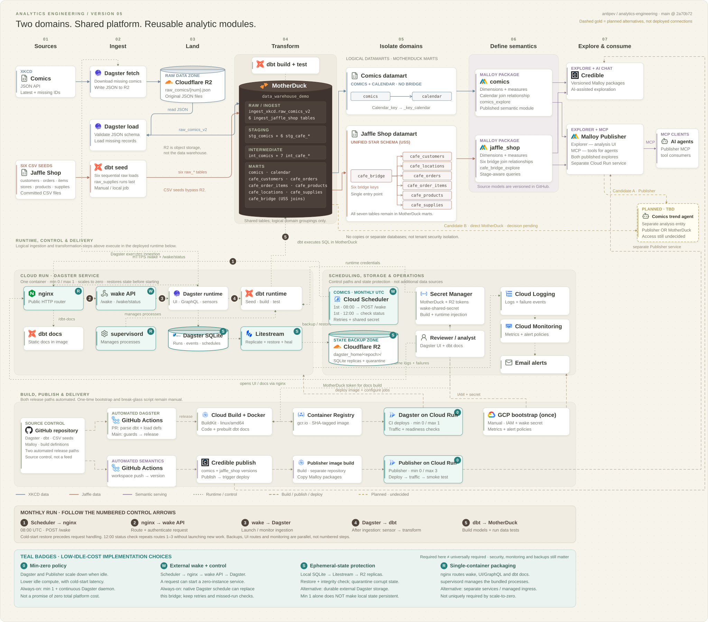
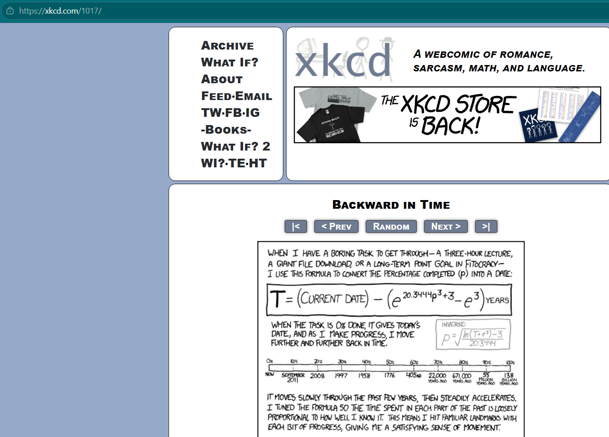
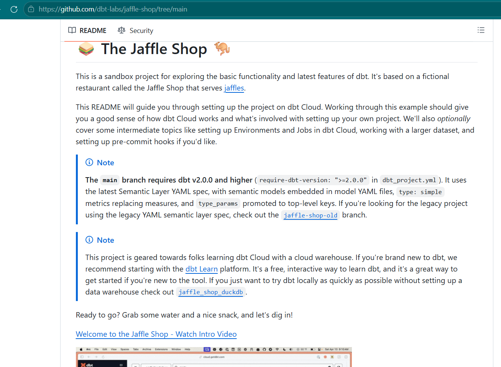
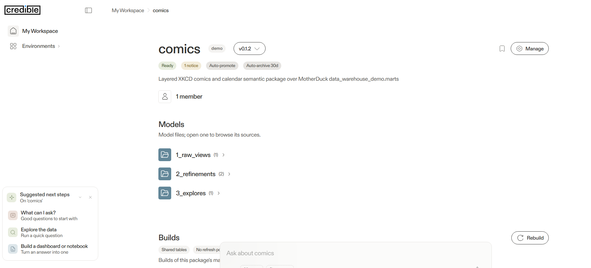
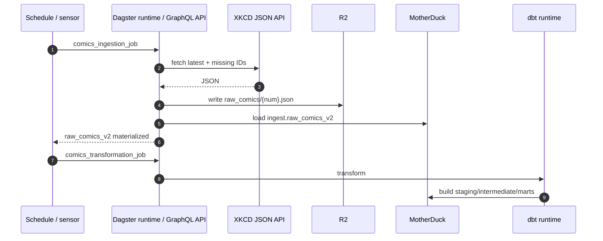
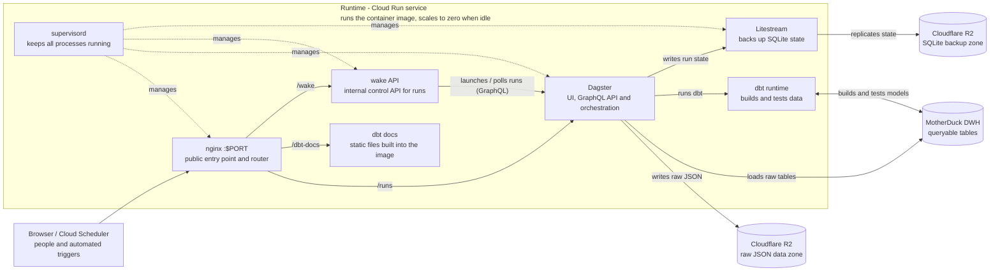
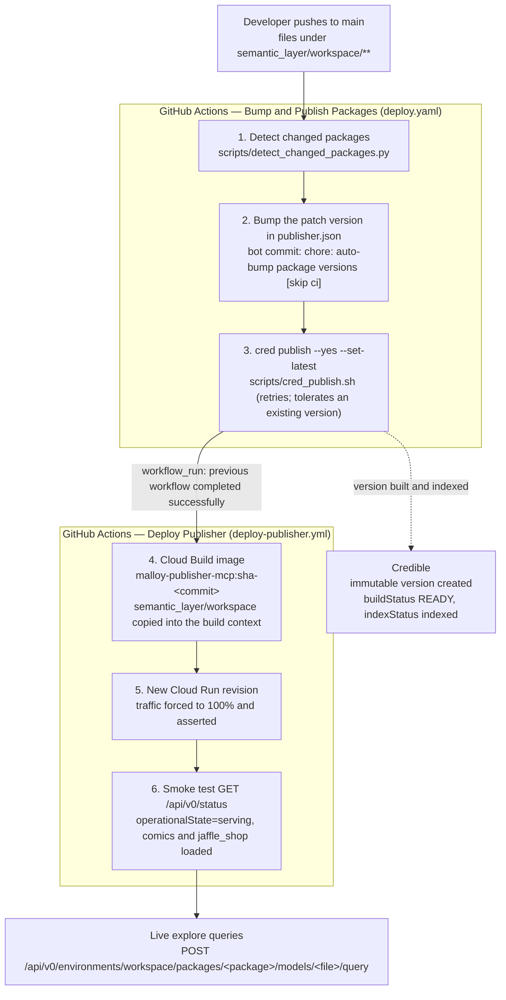
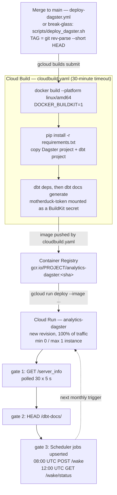

*Project overview: what the platform is, how it is built, how it is released, and the evidence that it runs in production. File-by-file inventory: [REPOSITORY_MAP.md](REPOSITORY_MAP.md).*

# Why?


**The Economics of Data, Analytics, and Digital Transformation by Bill Schmarzo**:
"One of the most significant impediments (`obstacles or things that slow down or block progress`) to realizing the economic value of one's data that was identified in the Economic Value of Data research was "orphaned analytics."

`Orphaned analytics` are one-off analytics developed to address a specific business need but never "operationalized" or packaged for reuse across the organization.

  - "Organizations lack an overarching framework to ensure that the resulting analytics and associated organizational intellectual capital can be captured and reused across multiple use cases. Without this over-arching analytics framework, organizations end up playing a game of analytics "whack-a-mole" where the analytics team focuses their precious and valuable resources on those immediate (urgent) problems, short-changing the larger, more strategic analytic opportunities."

"**The modern organization needs an overarching analytic module framework to help organizations to capture, share, reuse, and refine the organization's analytic `Intellectual Property (IP)`. For organizations to succeed in the 21st century, they `must invest the data science and engineering time` and discipline to master the `development of composable, reusable, continuously learning analytic modules`....that `deliver pre-defined business or operational outcomes`.**"


"The ability to leverage AI to create assets that appreciate (not depreciate) in value the more that they are used is a business and economics game-changer."


 - `digitalization`, which is the integration of digital technologies such as web-based apps, mobile devices, and sensors into existing operational processes

 - `Digital Transformation`, on the other hand, leverages the growing wealth of Big Data and Internet of Things (IoT) with continuously learning AI **to uncover new customer, product, service, and operational insights (propensities)** to **reinvent the organization's business models**, to derive and drive new sources of customer, product, and operational value.


# Analytics Engineering (XKCD & Jaffle Shop example)

`Analytics engineering` turns raw, messy data into clean, tested, documented datasets. Analytics engineers package this work as **reusable analytic modules** that teams can consume for business outcomes.


This repository applies that discipline to two independent domains on one shared platform:
- Dagster for orchestration,
- MotherDuck/DuckDB for storage,
- dbt for transformation, and
- Cloud Run for delivery.


Each domain owns its ingestion path, dbt models, marts, and business logic. Both pipelines and the Malloy semantic layer are implemented end to end; the AI trend-analysis agent remains a roadmap item.

[Public access](#public-access) · [Architecture](#architecture) · [Semantic layer](#semantic-layer) · [Orchestration](#orchestration-and-delivery) · [CI/CD](#cicd-and-deployment) · [Quick start](#quick-start) · [Repository map](REPOSITORY_MAP.md)

## Public access

| Resource | URL |
| --- | --- |
| Dagster UI | https://analytics-dagster-bolcwt6srq-nn.a.run.app/runs |
| dbt docs | https://analytics-dagster-bolcwt6srq-nn.a.run.app/dbt-docs/ |
| Health check | https://analytics-dagster-bolcwt6srq-nn.a.run.app/server_info |
| Malloy semantic layer (Publisher) | https://malloy-publisher-mcp-bolcwt6srq-nn.a.run.app |
| Credible workspace (sign-in required) | https://maxantipev.admin.credibledata.com/workspaces/workspace_demo |

## At a glance

| Domain | Business question | Source | Primary outputs |
| --- | --- | --- | --- |
| **XKCD** | How have technology, science, and gaming themes changed since 2005, and where should game development invest next? | XKCD JSON API | Incremental `comics` mart and `calendar` dimension |
| **Jaffle Shop** | How is a cafe performing across sales, customers, products, stores, and supplies? | Six CSV seeds from dbt Labs | `cafe_orders`, `cafe_customers`, `cafe_order_items`, `cafe_products`, `cafe_locations`, and `cafe_supplies` marts |

- **Implemented:** both ingestion and transformation pipelines, tests, documentation, orchestration, containerized deployment, the Malloy semantic layer, and automated Credible publishing plus Publisher rebuild/deploy.
- **Roadmap:** AI trend-analysis agent for XKCD.

## Architecture

**DWH** means **data warehouse**: the central database that stores raw, staged, and analytics-ready data and executes the transformation queries. In this project the DWH is **MotherDuck**, a cloud service built on DuckDB.

**API** means **application programming interface**: a defined way for one system to call another to exchange data or trigger an action. Three APIs are central to the architecture: the **XKCD JSON API** (external data API for comic retrieval), the **wake API** (internal control API inside the Cloud Run service, called by Cloud Scheduler), and the **Dagster GraphQL API** (internal orchestration API used by the Dagster UI and the wake API to launch and monitor runs).

### Architecture diagram

*Figure 1 — Analytics engineering architecture, version 5. Seven stages: sources → ingest → land → transform → isolate domains → define semantics → explore. Gold numbered markers (1–5) follow the monthly control path from Cloud Scheduler through nginx and the wake API into Dagster, dbt, and MotherDuck; the teal paths are the low-idle-cost runtime; the dashed gold paths are planned alternatives, not deployed connections.*

[](PICTURES/analytics-architecture-v5.svg)

Click the figure to open it at full size. The tracked file is a copy of `DOCUMENTATION/analytics-architecture-v5/analytics-architecture-v5.svg` (version 5, pinned to `2a70b72`); re-copy it from that folder when the diagram changes rather than editing it here.

MotherDuck and Dagster are shared by both domains. Object storage and the data warehouse are shown separately: the **R2** box keeps files and backups, while **MotherDuck** keeps queryable tables and runs SQL. R2 is split into two logical zones within the same bucket: the `raw_comics/` prefix is XKCD's JSON landing zone, while the `dagster_home/` prefix holds Litestream replicas of Dagster's SQLite state. The solid arrows show data lineage; Dagster executes the XKCD fetch, R2 write/read, and MotherDuck load. Jaffle Shop's raw layer is loaded into MotherDuck by `dbt seed` from the six CSV files committed to GitHub.

> **Cloud Run service, not a Cloud Run Job.** The deployed compute is a request-driven Cloud Run **service** with `min-instances=0` and `max-instances=1`. Cloud Scheduler wakes it over HTTPS; it is not a batch Cloud Run Job. See [Orchestration and delivery](#orchestration-and-delivery).

> **GitHub's role: source control, and the Dagster release path.** GitHub stores the Dagster code, dbt project, Dockerfile, release scripts, and seed CSVs. A merge to `main` that touches the orchestration, dbt, docker or build inputs runs `.github/workflows/deploy-dagster.yml`: `validate` loads the Dagster definitions and parses dbt, then `deploy` refuses to ship over a live run and runs `scripts/deploy_dagster.sh`, which builds with `gcloud builds submit .`, deploys the image and asserts the new revision is serving 100% of traffic. `scripts/deploy_dagster.sh` is still the whole release, so it remains the **break-glass** path when Actions is unavailable — run from a local checkout, it skips the definition check and the live-run guard. The semantic-layer publish/deploy path is automated separately; see [`semantic_layer/MALLOY_SEMANTIC_LAYER.md`](./semantic_layer/MALLOY_SEMANTIC_LAYER.md).

> **How Secret Manager is populated.** `scripts/bootstrap_gcp.sh` is a shell script run manually once from a developer terminal — not by Docker or Cloud Build. It enables Secret Manager, creates `wake-shared-secret`, and grants the runtime and build identities access. The MotherDuck and R2 secrets must already exist; create them manually with `gcloud secrets create` or the Google Cloud console. Cloud Build then consumes `motherduck-token` at build time, while `scripts/deploy_dagster.sh` reads `wake-shared-secret` and passes runtime secret references to Cloud Run.

> **Docker's role: build, not runtime.** Docker is not a separate deployed service. The `Dockerfile` defines the image, `cloudbuild.yaml` runs `docker build` with BuildKit inside Cloud Build, Cloud Build pushes the tagged image to Container Registry, and `scripts/deploy_dagster.sh` deploys that image to the Cloud Run service. Cloud Run runs the resulting container; there is no Docker daemon inside the service.

> **dbt: packaged at build time, executed at runtime.** The dbt project (models, seeds, tests, macros) is copied into the image and `dbt deps` plus `dbt docs generate` run during the image build, but no warehouse transformations or data tests run then. At runtime, Dagster launches the dbt assets, which build and test the models against MotherDuck. The diagram therefore keeps **dbt runtime** in the Cloud Run group.

### Component responsibilities

| Functional role | Technology | Responsibility |
| --- | --- | --- |
| **Input sources** | XKCD JSON API (external data API); six Jaffle Shop CSV seed files | Provide the two domains' source data. |
| **Source control** | [GitHub repository](https://github.com/antipev/analytics-engineering) | Stores Dagster code, dbt models/seeds/tests, Dockerfile, release scripts, and seed CSVs. A merge to `main` triggers `.github/workflows/deploy-dagster.yml`, which validates the definitions and runs the release script; bootstrap stays manual. |
| **Scheduling** | Cloud Scheduler | Starts `POST /wake` monthly at 08:00 UTC and checks `GET /wake/status` at 12:00 UTC; retries failures. |
| **Container image** | Dockerfile + Docker/BuildKit | Packages Dagster and dbt source, generated static dbt docs, Python 3.12, nginx, and Litestream into the `linux/amd64` image. |
| **Build and release** | GitHub Actions + Cloud Build + Container Registry + `scripts/deploy_dagster.sh` | The workflow runs the release script on merge; the script submits the checkout to Cloud Build, deploys the tagged image to Cloud Run, re-points both Scheduler jobs and asserts the new revision is serving 100% of traffic. The same script is the break-glass path when Actions is unavailable. |
| **Container compute** | Cloud Run service (one container, min 0 / max 1) | Runs the packaged image: nginx, wake API, Dagster runtime, dbt runtime, static dbt docs, and Litestream; scales to zero when idle. |
| **HTTP entry point** | nginx | Routes public traffic to the Dagster UI/GraphQL API, static dbt docs, and the wake endpoints. Cloud Run terminates TLS at the edge. |
| **Run control** | Starlette/uvicorn wake API (internal control API) | Authenticates Scheduler, calls Dagster's GraphQL API to launch the monthly ingestion idempotently, waits for the sensor-triggered transformation, and reports status. |
| **Orchestration** | Dagster runtime (webserver + GraphQL API) | Defines assets, jobs, the monthly schedule, and two asset sensors; serves the UI and GraphQL API; stores run and schedule state in SQLite. |
| **Transformation** | dbt runtime | Executes only when Dagster launches the dbt assets; builds staging/intermediate/mart models and runs tests against the DWH. |
| **Data warehouse (DWH)** | MotherDuck on DuckDB (free tier 10 GB for individuals) | Stores queryable raw, staging, and mart tables and executes dbt SQL. |
| **Semantic layer** | Malloy Publisher + Credible | Publishes reusable metrics and dimensions over the MotherDuck mart tables, managed from the `semantic_layer/workspace/` packages and deployed automatically after a successful Credible publish. |
| **Object storage** | Cloudflare R2 (free tier up to 10 GB) | Two logical zones in one bucket: `raw_comics/` stores raw XKCD JSON, and `dagster_home/` stores Litestream backups of Dagster's SQLite state. |
| **State protection** | Litestream + restore script | Replicates SQLite continuously and restores run history and schedule state before Dagster starts on a cold instance. |
| **Configuration** | Secret Manager + environment variables | `bootstrap_gcp.sh`, run manually, creates `wake-shared-secret` and grants IAM; MotherDuck and R2 secrets must exist beforehand. Cloud Build reads `motherduck-token` for build-time dbt docs; the deploy script reads `wake-shared-secret` and injects runtime secret references into Cloud Run. No secret is baked into the image. |
| **Observability** | Cloud Logging + Cloud Monitoring | Converts failure logs into metrics and sends email alerts. |

### Monthly request path

1. **08:00 UTC on the 1st:** Cloud Scheduler sends an authenticated `POST /wake` to the wake API. Cloud Run starts the container from zero if needed, restores Dagster state from R2, and starts nginx, Dagster, the wake API, and Litestream.
2. **Ingestion:** the wake API launches `comics_ingestion_job` idempotently. Dagster downloads only missing comics from the XKCD API into R2, then loads them into `MotherDuck.ingest_xkcd.raw_comics_v2`.
3. **Transformation:** materializing `raw_comics_v2` fires the asset sensor, which launches `comics_transformation_job`. dbt builds and tests the staging, intermediate, and mart models in MotherDuck.
4. **Confirmation:** `/wake` waits for both runs and returns success only when both succeed. At **12:00 UTC**, a second Scheduler job calls `GET /wake/status` as a dead-man's-switch; failures produce structured logs and email alerts.
5. **Idle:** the service scales back to zero. MotherDuck keeps the analytics tables; R2 keeps raw JSON and the replicated Dagster run/schedule state.

## Domain 1 — XKCD

**Business question.** How did public interest in technology, science, and gaming culture shift over two decades, and which directions are most likely to succeed in game development?

**Why it matters.** Tracking themes year by year helps identify topics with adoption potential, reducing the financial risk of new game concepts.



*[xkcd.com](https://xkcd.com/) is the source for this domain; the JSON API provides each comic's title, date, and transcript.*

**Pipeline.**
- On the first day of each month at 08:00 UTC, Cloud Scheduler calls `POST /wake`. The endpoint launches `comics_ingestion_job` and waits for the sensor-triggered transformation. The in-code Dagster schedule exists but is stored as `STOPPED`; Cloud Scheduler is the single monthly trigger.
- The job reads the latest comic number from the XKCD API, compares it with the IDs already stored in R2, and downloads only the gaps. Comic #404 is skipped because the site returns its "not found" page for that ID.
- Downloads use a 20-worker thread pool and write one JSON file per comic under `raw_comics/`. A `full_refresh` option re-downloads everything.
- A second asset loads missing R2 files into MotherDuck in batches as `ingest_xkcd.raw_comics_v2`. Raw JSON remains in R2; MotherDuck holds the queryable copy.
- dbt moves the data through `stg_comics` and `int_comics` into an incremental `comics` mart keyed by comic number, plus a `calendar` dimension.

**Outputs.** A tested, documented comics mart ready for keyword and trend analysis. Sources: [xkcd.com](https://xkcd.com/) · [JSON API](https://xkcd.com/info.0.json).

## Domain 2 — Jaffle Shop

**Business question.** How is the cafe performing across sales, customers, products, stores, and supplies?

**Why it matters.** Operators need one consistent view of revenue, order composition, customer lifetime value, product and store performance, and supply costs instead of manual spreadsheet reporting.



*The [dbt Labs Jaffle Shop](https://github.com/dbt-labs/jaffle-shop) sample project is the source for the cafe domain: its six CSV seeds load into `ingest_jaffle_shop`.*

**Pipeline.**
- Six CSV seeds from the [dbt Jaffle Shop project](https://github.com/dbt-labs/jaffle-shop) load into MotherDuck's `ingest_jaffle_shop` schema: `raw_customers`, `raw_orders`, `raw_items`, `raw_stores`, `raw_products`, and `raw_supplies`.
- The seed assets are chained in that order to avoid concurrent schema creation and write conflicts.
- Materializing the final seed, `raw_supplies`, triggers `jaffle_shop_transformation_job`.
- dbt builds staging models and six `cafe_` marts: `cafe_customers`, `cafe_orders`, `cafe_order_items`, `cafe_products`, `cafe_locations`, and `cafe_supplies`.

**Outputs.** A tested, documented cafe analytics layer covering the full sales and operations lifecycle.

## Semantic layer

The semantic layer sits on top of the dbt marts in MotherDuck. It is version-controlled under `semantic_layer/workspace/` and published as two Malloy packages, `comics` and `jaffle_shop`. Credible builds and versions each package from `1_raw_views`, `2_refinements`, and `3_explores`; Malloy Publisher serves the compiled explores for interactive analysis and MCP access by AI agents. Pushes to `semantic_layer/workspace/**` trigger the GitHub Actions publish and Publisher rebuild/deploy path.


*MotherDuck holds the raw and transformed tables; the semantic packages read the `marts` schema in `data_warehouse_demo`.*



*Credible tracks the `comics` package as a versioned build with raw views, refinements, and the published explore.*


*Malloy Publisher runs `comics_explore` against MotherDuck and returns yearly comic counts and transcript-word measures.*

## Orchestration and delivery

| Domain | Ingestion job | Transformation job | Trigger |
| --- | --- | --- | --- |
| XKCD | `comics_ingestion_job` | `comics_transformation_job` | Cloud Scheduler `POST /wake` at 08:00 UTC on the 1st; sensor on `raw_comics_v2` |
| Jaffle Shop | `jaffle_shop_ingestion_job` | `jaffle_shop_transformation_job` | Manual/local run; sensor on `raw_supplies`, the final seed |



Jaffle Shop follows the same handoff pattern: six chained seeds replace the XKCD API/R2 step, and the final seed triggers its transformation job.


*Dagster's global asset lineage shows both domains, from raw assets through their final marts.*



- nginx exposes the public Cloud Run port and proxies `/runs`, `/dbt-docs/`, `/wake`, and `/wake/status`.
- dbt project code is copied into the image at build time; transformations and tests execute only when Dagster launches the dbt assets.
- dbt docs are generated at image-build time and served as static files, so a cold start does not need to query MotherDuck for catalog metadata.
- `/wake` is authenticated with the `X-Wake-Secret` header and can wait up to 25 minutes (1500 seconds), behind a 30-minute Scheduler and proxy deadline.
- Litestream replicates Dagster's SQLite databases to the R2 backup zone; the entrypoint restores them before Dagster starts. Raw XKCD JSON lives in the R2 data zone.
- The dbt assets and seed assets expose a runtime `full_refresh` option for selected rebuilds.

## CI/CD and deployment

Three things ship into production, at two very different levels of automation:

| Path | What ships | What starts it | Automation |
| --- | --- | --- | --- |
| **Data refresh** | Tables in MotherDuck: `staging` → `intermediate` → `marts` | `jaffle_shop_transformation_job` in Dagster (manual today), or `POST /wake` → sensor → `comics_transformation_job` for XKCD | manual — a person or Cloud Scheduler launches the Dagster job |
| **Semantic layer release** | The `comics` and `jaffle_shop` Malloy packages on Credible, then the Malloy Publisher revision that serves them | Any `git push` to `main` that touches `semantic_layer/workspace/**` | fully automated — GitHub Actions runs every step, including the version bump |
| **Orchestrator release** | The `analytics-dagster` Cloud Run image: Dagster, dbt, the wake API, nginx and Litestream in one container | A merge to `main` that touches the orchestration, dbt, docker or build inputs | automated — GitHub Actions validates the definitions and runs `scripts/deploy_dagster.sh`, which builds, deploys and re-points both Scheduler jobs; the script is also the break-glass path (see [How Dagster itself gets deployed](#how-dagster-itself-gets-deployed)) |

The semantic layer writes no data: it describes the `marts.*` tables dbt already built. So the order is **refresh the data first, release the semantics second**. A release published before a refresh still passes every gate below — it just describes yesterday's numbers.

### The release train



Two guards keep this loop from running on itself: `deploy.yaml` skips commits authored by `credible-bot[bot]` or carrying `[skip ci]`, and `deploy-publisher.yml` only fires when the publish workflow **succeeded** (`workflow_run` with `conclusion == 'success'`), so a failed publish never replaces a working Publisher image.

### What each gate actually tests

The gates run shallow to deep: parse first, then build, then serve, then answer a business question.

| Gate | Where it runs | Command / file | Green means | Red means |
| --- | --- | --- | --- | --- |
| **1. Change detection** | Actions → `deploy.yaml`, `bump` job | `scripts/detect_changed_packages.py <before> <head>` | only the packages whose files changed are rebuilt, so a `comics` edit does not republish `jaffle_shop` | a changed file has no `publisher.json` above it, or the change landed outside `semantic_layer/workspace/**` |
| **2. Version bump** | `.github/workflows/bump-package-versions.yml` | `scripts/bump_versions.py`, then a bot commit | `publisher.json` holds a version Credible has never seen; published versions are immutable, so the bump is what makes a republish possible at all | the bot app secrets are missing, or the push raced another commit |
| **3. Publish and compile** | `.github/workflows/publish-packages.yml` → `scripts/cred_publish.sh` | `cred publish --yes --set-latest` | every `.malloy` file parses, every `rename:` target exists on its physical table, every explore compiles, and Credible creates the version | **this is the only place Malloy is compiled in CI** — a stale column name fails here, before Publisher ever sees the code |
| **4. Image build** | `.github/workflows/deploy-publisher.yml` | `gcloud builds submit` after `scripts/sync_semantic_layer.sh` | the Publisher image contains exactly this repo's `semantic_layer/workspace` | a package was not copied into the build context |
| **5. Revision and traffic** | same workflow | `gcloud run deploy` + `gcloud run services update-traffic` | a new revision exists **and** 100% of traffic is on it, so the smoke test cannot pass against the previous revision | a stale control-plane response left the old revision serving |
| **6. Smoke test** | same workflow | `curl /api/v0/status`, parsed as JSON | the service is `serving`, both `comics` and `jaffle_shop` appear in `packages[]`, and `loadErrors` is empty | the container is up but a package failed to load — usually a connection or compile problem inside `workspace/`, or a `marts` table that no longer matches the package |
| **7. Data check** (manual) | your terminal | `POST …/models/…/query` | the deployed explore returns the same numbers dbt produces | the package compiles but reads the wrong tables, or the data refresh never ran |

Gates 1–6 are plumbing: they prove the code compiles, the image is current, and the service answers. **Only gate 7 proves the semantics** — that `cafe_bridge_explore` returns 686 orders and 7,226.67 revenue for the `cafe_orders` stage, matching `dbt build`.

### Where the dbt tests run (they are not in CI)

There is no dbt workflow. The 72 data tests and 3 unit tests run when Dagster materializes the dbt assets, and the gate for a pull request is the local build:

```bash
dbt build --select jaffle_shop    # 20 models + 72 data tests + 3 unit tests = PASS=95
```

That is a deliberate split: GitHub Actions owns the **semantic layer** (fast, stateless, no warehouse access beyond Credible's compile), Dagster owns the **warehouse build and tests** (stateful, needs MotherDuck, writes tables).

### How Dagster itself gets deployed

**Yes — Dagster runs on Cloud Run**, as one service called `analytics-dagster` in `northamerica-northeast1`, serving `https://analytics-dagster-bolcwt6srq-nn.a.run.app`. One container holds everything the pipeline needs at runtime (nginx, the wake API, Dagster with its UI and GraphQL API, the dbt runtime, the static dbt docs and Litestream).

The container is built and shipped by `.github/workflows/deploy-dagster.yml` on merge to `main`, which runs `scripts/deploy_dagster.sh` after validating the definitions. The script is also the documented break-glass path: run it directly when Actions is unavailable, accepting that it skips the definition check and the live-run guard.



| Step | What the script runs | What green means |
| --- | --- | --- |
| 0. One-time bootstrap | `scripts/bootstrap_gcp.sh` (not run by the deploy script) | APIs enabled, `wake-shared-secret` created, runtime and Cloud Build identities granted secret access, two log-based metrics, an email notification channel and one alert policy per failure source exist |
| 1. Build | `gcloud builds submit --config=cloudbuild.yaml --substitutions=_TAG=$TAG,_SERVICE=analytics-dagster .` | Docker produces a `linux/amd64` image on the `python:3.12-slim` base with nginx, supervisor and Litestream, installs the pinned `requirements.txt`, runs `dbt deps`, and generates dbt docs **at build time** — the MotherDuck token is mounted as a build secret, so it never lands in an image layer |
| 2. Push | the `images:` block in `cloudbuild.yaml` | `gcr.io/<project>/analytics-dagster:<git-short-sha>` exists in Container Registry |
| 3. Deploy | `gcloud run deploy analytics-dagster --image=… --allow-unauthenticated` with the scaling flags and `--set-secrets`, then `gcloud run services update-traffic --to-latest` | Cloud Run creates a new revision; the explicit `update-traffic` clears any revision-name pin, and the script then asserts that `status.latestCreatedRevisionName` is the revision on 100% of traffic, exiting non-zero otherwise |
| 4. Readiness | `curl -fsS $URL/server_info` retried 30 times, 5 s apart | nginx is up and proxying to Dagster's web server — if this never answers within 150 s the script **exits non-zero** |
| 5. Docs | `curl -fsSI $URL/dbt-docs/` | the docs baked into the image are served from static files, not generated on cold start |
| 6. Scheduler | `gcloud scheduler jobs create` or `update http`, twice | both jobs point at the current service URL and carry the current `X-Wake-Secret`, with 3 retries and 60–300 s backoff |

The scaling and secret configuration lives in the script, not in the console:

| Setting | Value in `deploy_dagster.sh` | Why |
| --- | --- | --- |
| Service and region | `analytics-dagster`, `northamerica-northeast1` | one region for Run, Scheduler and the image |
| Instances | `--min-instances=0 --max-instances=1` | scales to zero when idle; the cap is 1 because the container owns the SQLite state and two instances would mean two copies of it |
| Resources | `--cpu=1 --memory=2Gi --concurrency=200` | dbt, Dagster, nginx and Litestream share one container; concurrency 200 absorbs the UI's parallel GraphQL and `/_next/static/*` requests |
| CPU and timeout | `--no-cpu-throttling --cpu-boost --timeout=3600` | a dbt run must keep CPU after the HTTP response is sent, and it can outlast the 25-minute wake deadline |
| Environment | `DAGSTER_HOME=/tmp/dagster_home`, R2 bucket and prefix, `MOTHERDUCK_DATABASE`, job names, `WAKE_TIMEOUT_SECONDS=1500` | the container is stateless apart from `/tmp`, which Litestream protects |
| Secrets | `--set-secrets` for `MOTHERDUCK_TOKEN`, `R2_ACCOUNT_ID`, `R2_ACCESS_KEY_ID`, `R2_SECRET_ACCESS_KEY`, `WAKE_SHARED_SECRET` | values come from Secret Manager at runtime; nothing is baked into the image or committed |

Every cold start replays the same boot sequence inside the container (`docker/entrypoint.sh` and `docker/supervisord.conf`):

1. `restore_dagster_state.py` restores Dagster's SQLite databases — `runs.db`, the per-run event logs and `schedules.db` — from the R2 backup zone.
2. `ensure_schedule_stopped.py` forces the restored monthly schedule to `STOPPED`, so a schedule left running by an older deployment cannot tick and race `/wake`.
3. nginx's config is rendered from Cloud Run's `$PORT`.
4. supervisord starts the processes in dependency order: Litestream (priority 5), `dg dev` on `127.0.0.1:3000` (10), the wake API on `127.0.0.1:3001` (15), and nginx last (20) — nginx's start script waits for `/server_info` before it accepts traffic.

Three consequences worth knowing:

- **This path has no data gate.** The script proves the image is current and the service answers; it does not run a job, and it cannot tell you whether dbt still passes. That is the Dagster run itself, and today a person watches it — which is exactly how a run gets left stuck at `STARTED` (see the failure table below).
- **A revision-name traffic pin is a trap.** `gcloud run deploy` honours an existing `--to-revisions=<name>=100` pin: it creates the revision, reports success and leaves the old revision serving (F4). The script therefore ends with an explicit `update-traffic --to-latest` and an assertion that the newest revision holds 100%, so a green run means a live deploy and the next run is never a silent no-op. A rollback drill must also finish on `--to-latest`, not on a revision name.
- **The script is the source of truth for service config.** Any flag changed by hand in the Cloud Run console is invisible to the repository and is replaced the next time `gcloud run deploy` runs. Change `scripts/deploy_dagster.sh`, not the console.

To see which image is actually live:

```bash
gcloud run services describe analytics-dagster \
  --region northamerica-northeast1 \
  --format='value(status.latestCreatedRevisionName, spec.template.spec.containers[0].image)'
# analytics-dagster-00014-kol   gcr.io/my-1-st-project-training/analytics-dagster:e1c5337
```

The tag after the colon is the short git SHA of the checkout that was deployed, so the image identifies its own source commit — the same property the Publisher image gets from `sha-<commit>` tags.

### What a failure looks like

Four failures I actually hit while shipping this, and what each one taught:

| Symptom | Gate | Cause | Fix |
| --- | --- | --- | --- |
| `cred publish` fails while renaming a key: `_key_cafe_customers` "not found" on `marts.cafe_customers`, even though the column exists | 3 | Credible compiles against a **cached table description**, so a column added or renamed by the latest dbt run is invisible until the cache expires | qualify the source with the database: `motherduck.table('data_warehouse_demo.marts.cafe_customers')`. The changed table reference invalidates the description, so the compile is deterministic instead of lucky |
| `404 {"message":"Query target is not queryable."}` from the query endpoint | 7 | either the model path is not in the revision currently serving (release still rolling), or the query uses a joined-source measure without qualifying it (`Order_Count` instead of `cafe_orders.Order_Count`) | wait for gates 5–6, then take the exact `packageName` and `path` from `GET …/packages/<pkg>/models`, and qualify joined measures |
| Run stuck at `STARTED`, `stepsSucceeded: 0`, `stepsFailed: 1`, one step `domain_data_products` failing with `DagsterExecutionInterruptedError` | data refresh | the run was launched straight over GraphQL on the autoscaled Dagster service and the Cloud Run instance idled out mid-run, killing the dbt process before Dagster could record a terminal status | use `POST /wake` (it holds the request open for up to 1,500 s) or launch from the Dagster UI while the instance is warm, then re-run the job — a run left in this state never resolves itself |
| `Publisher did not reach a serving state with both packages` | 6 | the image shipped without one package, or `/api/v0/status` never reached `serving` | check `sync_semantic_layer.sh` output in the build log, then the Cloud Run logs for the package load error |

### Watching a release

The whole chain is observable from a terminal — these are the commands behind the status line "shipped":

```bash
# 1-2. which workflow is running, and how it ended
gh run list --limit 5

# 3. the version Credible considers latest, and whether that version built
cred get package  jaffle_shop | grep latestVersion
cred get version  jaffle_shop <version> | grep -E 'buildStatus|indexStatus'

# 4-5. which revision is actually serving
gcloud run services describe malloy-publisher-mcp \
  --region northamerica-northeast1 \
  --format='value(status.traffic[0].revisionName)'

# 6. the same assertion the smoke test makes
curl -s https://malloy-publisher-mcp-bolcwt6srq-nn.a.run.app/api/v0/status \
  | python3 -c "import sys,json;[print(p['name']) for e in json.load(sys.stdin)['environments'] for p in e['packages']]"

# 7. the check that proves the semantics, not the plumbing
curl -s -X POST \
  'https://malloy-publisher-mcp-bolcwt6srq-nn.a.run.app/api/v0/environments/workspace/packages/jaffle_shop/models/3_explores%2Fcafe_bridge_explore.malloy/query' \
  -H 'Content-Type: application/json' \
  -d '{"query":"run: cafe_bridge_explore -> { where: Stage = \"cafe_orders\"; aggregate: Bridge_Row_Count, cafe_orders.Order_Count, cafe_orders.Total_Revenue, cafe_orders.Total_Items }","compactJson":true}'
```

### Worked example — the Unified Star Schema release

The chain, as it ran on 2026-10-22/23 (all values read back from GitHub, Credible, Cloud Run and MotherDuck):

| Time (UTC) | Gate | Result |
| --- | --- | --- |
| 01:19:45 | 2 — bump | bot commit `ed7ff0d` sets `jaffle_shop` to `0.1.6` (published versions are immutable, so the previous `0.1.5` could not be overwritten) |
| 01:20:12 | 3 — publish | Credible creates version `0.1.6`: the `_Key_*` renames and the database-qualified sources compile |
| 01:20:19 → 01:29:06 | 4–5 — build, deploy | workflow run `39883416125` succeeds; revision `malloy-publisher-mcp-00032-kg5` takes 100% of traffic |
| 01:29:06 | 6 — smoke | log line `Publisher is serving both semantic packages.` |
| after | 7 — data | `Stage = 'cafe_orders'` → 686 orders, 7,226.67 revenue, 997 items; bridge total 1,892 rows, matching `marts.cafe_bridge` and the dbt aggregates |

Gate 7 is the one that matters for the business question, and it is the one no workflow asserts — which is why it is written down here as a manual step rather than assumed. The next release (`0.1.7`, revision `malloy-publisher-mcp-00033-c7z`) returned the same 686 / 7,226.67 / 997, which is the expected result: that commit only removed an unused dimension, so nothing downstream should move.

### Configuration the train needs

| Name | Kind | Read by |
| --- | --- | --- |
| `CICD_BOT_APP_ID`, `CICD_BOT_APP_PRIVATE_KEY` | repository secrets | gate 2 — mint a token to push the bump commit |
| `CRED_JWT` | repository secret | gate 3 — `cred set-access-token` |
| `GCP_WORKLOAD_IDENTITY_PROVIDER`, `GCP_SERVICE_ACCOUNT` | repository secrets | gates 4–6 — keyless auth to Cloud Build and Cloud Run |
| `CRED_ORG`, `CRED_ENV` (falls back to the older `CRED_PROJECT`), `SET_LATEST` | repository variables | gate 3 — target organization and environment, and whether the version becomes latest |

The package-side rules that make this train safe (immutable versions, one owner per package, no cross-repository symlinks) are in [semantic_layer/MALLOY_SEMANTIC_LAYER.md](semantic_layer/MALLOY_SEMANTIC_LAYER.md#credible-publishing).

## Validation

| Check | Result |
| --- | --- |
| `dg list defs` | Resolves four domain-scoped jobs, two sensors, and one schedule |
| `dbt parse --target motherduck_dev` | Validates the dbt project |
| Local XKCD run | 3,302 comics loaded and 3,302 rows in the comics mart; counts grow with each scheduled run |
| MotherDuck raw table | `ingest_xkcd.raw_comics_v2` |
| Cloud Run | One container serves the Dagster UI and dbt docs |


*dbt docs expose source descriptions, columns, and the linked Dagster asset key.*

## Quick start

### Local

```bash
cp .env.example .env        # repository root; fill in GCP, R2, and MotherDuck values
uv venv .venv --python 3.10 # first time only; one environment for the whole repo
source .venv/bin/activate
uv sync --project ingestion/orchestration_dagster --active
cd ingestion/orchestration_dagster
dg dev
```

Open `http://localhost:3000` and run `comics_ingestion_job` or `jaffle_shop_ingestion_job`.

The repository-root `.venv` is the single environment for the whole project. It contains Dagster, dbt, and every dependency from `ingestion/orchestration_dagster/uv.lock`. Because `uv` normally creates the environment next to `pyproject.toml`, dependency updates must be synced into the active root environment with `uv sync --project ingestion/orchestration_dagster --active`. Run `dg` and `dbt` from `ingestion/orchestration_dagster` so Dagster finds its `defs` directory.

`.env` in the repository root is the single environment file. Dagster loads it through `python-dotenv` (the loader walks up from the project directory), and `scripts/bootstrap_gcp.sh` / `scripts/deploy_dagster.sh` source it automatically. For dbt CLI commands, load it into the shell first from the repository root: `set -a; source .env; set +a`.

### Run jaffle_shop models locally

```bash
set -a; source .env; set +a                     # from the repository root — provides the MotherDuck token
source .venv/bin/activate
cd transformation_dbt/domain_data_products      # the dbt project directory
```

Run these from the same dir/venv — they use the project's default target (`motherduck_dev`):

```bash
# the whole domain — 20 models, 72 data tests + 3 unit tests
dbt test --select jaffle_shop

# compile only
dbt compile --select jaffle_shop

# build = run + test in DAG order (the full gate for this project)
dbt build --select jaffle_shop
```

Per-layer:

```bash
dbt test --select jaffle_shop.staging        # 19 nodes
dbt test --select jaffle_shop.intermediate   # 35 nodes  (the _key_ + bridge contract)
dbt test --select jaffle_shop.marts          # 28 nodes
```

Per-model (useful when reviewing one step at a time, e.g. the USS key layer):

```bash
dbt test --select int_cafe_customers int_cafe_locations int_cafe_products \
                  int_cafe_supplies int_cafe_orders int_cafe_order_items
dbt test --select cafe_orders+     # a model and everything downstream of it
```

Debugging variants:

```bash
dbt test --select jaffle_shop --fail-fast        # stop at the first failure
dbt test --select jaffle_shop --store-failures   # write failing rows to the target schema for inspection
dbt ls   --select jaffle_shop --resource-type test --output name   # list what would run, without running it
```

Expected output — `dbt test --select jaffle_shop` reports the 72 data tests plus the
three unit tests; under `dbt build` the same selection also runs the 20 models, so the
total is `PASS=95`:

```
Done. PASS=75 WARN=0 ERROR=0 SKIP=0 NO-OP=0 REUSED=0 TOTAL=75
```

Two notes:
- `--select jaffle_shop` is a **path** selector, so it covers all 20 models and every
  test under `models/jaffle_shop/` plus the two singular tests in `tests/`. Seeds
  (`dbt seed`) and the `ecom` source freshness are not included.
- The per-layer counts add up to more than the domain total because the selectors
  overlap: a `relationships` test that spans two layers is reachable from both, the
  singular `assert_cafe_bridge_row_counts_match_sources` reads both the bridge and the
  `cafe_*` marts (intermediate + marts), and the unit tests are reachable from the
  layer that owns the tested model. The domain total is the authoritative number.

Layer and model naming follow one rule per folder — `staging/stg_cafe_*`, `intermediate/int_cafe_*`, `marts/cafe_*`, each with a single schema YAML (`_stg_cafe_models.yml`, `_int_cafe_models.yml`, `_cafe_models.yml`). The key contract these intermediate tests enforce is documented in the USS implementation plan (section 12 of the local documentation set, which is not versioned in GitHub).

## Repository map

The full file-by-file inventory is in [REPOSITORY_MAP.md](REPOSITORY_MAP.md). It covers the root/build/deployment files, Docker runtime, Dagster orchestration, dbt project, semantic layer, documentation, and generated/local-only paths.

## Roadmap

- **AI trend-analysis agent for XKCD** — consumes the comics mart to produce trend analyses and strategic input for game development. Not implemented yet.
- **Dagster release automation** — done: a merge to `main` triggers `.github/workflows/deploy-dagster.yml` (definitions check, live-run guard, build, deploy, traffic assert). `scripts/deploy_dagster.sh` remains the break-glass path. Optional next step: a data gate that runs `dbt build` against a throwaway DuckDB before the image is built.
