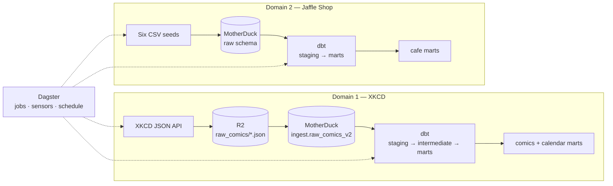
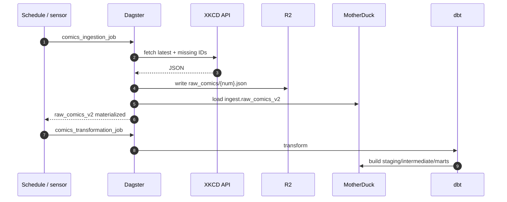
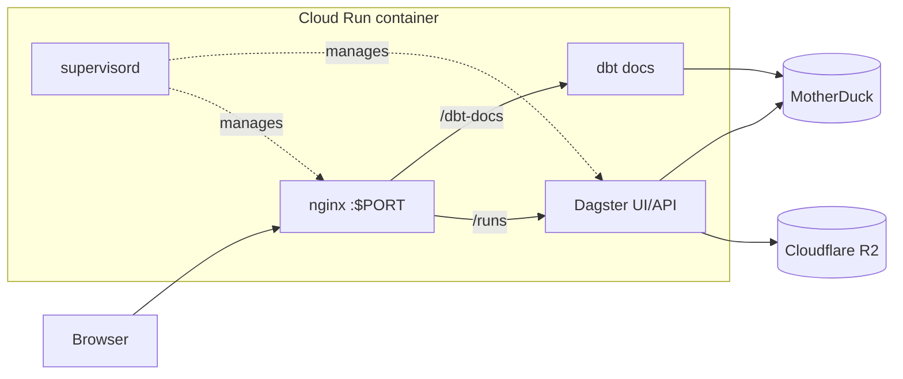

# Analytics Engineering — XKCD & Jaffle Shop

Analytics engineering turns raw, messy data into clean, tested, documented datasets. This repository applies that discipline to two independent domains on one shared platform: Dagster for orchestration, MotherDuck/DuckDB for storage, dbt for transformation, and Cloud Run for delivery.

Each domain owns its ingestion path, dbt models, marts, and business logic. Both pipelines are implemented end to end; the semantic and AI layers are roadmap items.

[Public access](#public-access) · [Architecture](#architecture) · [Orchestration](#orchestration-and-delivery) · [Quick start](#quick-start) · [Repository map](#repository-map)

## Public access

| Resource | URL |
| --- | --- |
| Dagster UI | https://analytics-dagster-bolcwt6srq-nn.a.run.app/runs |
| dbt docs | https://analytics-dagster-bolcwt6srq-nn.a.run.app/dbt-docs/ |
| Health check | https://analytics-dagster-bolcwt6srq-nn.a.run.app/server_info |

## At a glance

| Domain | Business question | Source | Primary outputs |
| --- | --- | --- | --- |
| **XKCD** | How have technology, science, and gaming themes changed since 2005, and where should game development invest next? | XKCD JSON API | Incremental `comics` mart and `calendar` dimension |
| **Jaffle Shop** | How is a cafe performing across sales, customers, products, stores, and supplies? | Six CSV seeds from dbt Labs | `cafe_orders`, `cafe_customers`, `cafe_order_items`, `cafe_products`, `cafe_locations`, and `cafe_supplies` marts |

- **Implemented:** both ingestion and transformation pipelines, tests, documentation, orchestration, and containerized deployment.
- **Roadmap:** Malloy semantic layer and an AI trend-analysis agent for XKCD.

## Architecture



MotherDuck and Dagster are shared. R2 is XKCD's raw landing zone; Jaffle Shop's raw layer lives in MotherDuck.

## Domain 1 — XKCD

**Business question.** How did public interest in technology, science, and gaming culture shift over two decades, and which directions are most likely to succeed in game development?

**Why it matters.** Tracking themes year by year helps identify topics with adoption potential, reducing the financial risk of new game concepts.

**Pipeline.**
- A schedule runs `comics_ingestion_job` every Monday, Wednesday, and Friday at 08:00.
- The job reads the latest comic number from the XKCD API, compares it with the IDs already stored in R2, and downloads only the gaps. Comic #404 is skipped because the site returns its "not found" page for that ID.
- Downloads use a 20-worker thread pool and write one JSON file per comic under `raw_comics/`. A `full_refresh` option re-downloads everything.
- A second asset loads missing R2 files into MotherDuck in batches as `ingest.raw_comics_v2`. Raw JSON remains in R2; MotherDuck holds the queryable copy.
- dbt moves the data through `stg_comics` and `int_comics` into an incremental `comics` mart keyed by comic number, plus a `calendar` dimension.

**Outputs.** A tested, documented comics mart ready for keyword and trend analysis. Sources: [xkcd.com](https://xkcd.com/) · [JSON API](https://xkcd.com/info.0.json).

## Domain 2 — Jaffle Shop

**Business question.** How is the cafe performing across sales, customers, products, stores, and supplies?

**Why it matters.** Operators need one consistent view of revenue, order composition, customer lifetime value, product and store performance, and supply costs instead of manual spreadsheet reporting.

**Pipeline.**
- Six CSV seeds from the [dbt Jaffle Shop project](https://github.com/dbt-labs/jaffle-shop) load into MotherDuck's `raw` schema: `raw_customers`, `raw_orders`, `raw_items`, `raw_stores`, `raw_products`, and `raw_supplies`.
- The seed assets are chained in that order to avoid concurrent schema creation and write conflicts.
- Materializing the final seed, `raw_supplies`, triggers `jaffle_shop_transformation_job`.
- dbt builds staging models and six `cafe_` marts: `cafe_customers`, `cafe_orders`, `cafe_order_items`, `cafe_products`, `cafe_locations`, and `cafe_supplies`.

**Outputs.** A tested, documented cafe analytics layer covering the full sales and operations lifecycle.

## Orchestration and delivery

| Domain | Ingestion job | Transformation job | Trigger |
| --- | --- | --- | --- |
| XKCD | `comics_ingestion_job` | `comics_transformation_job` | Schedule at 08:00 Mon/Wed/Fri; sensor on `raw_comics_v2` |
| Jaffle Shop | `jaffle_shop_ingestion_job` | `jaffle_shop_transformation_job` | Sensor on `raw_supplies`, the final seed |



Jaffle Shop follows the same handoff pattern: six chained seeds replace the API/R2 step, and the final seed triggers its transformation job.


*Dagster's global asset lineage shows both domains, from raw assets through their final marts.*



- nginx exposes the public Cloud Run port and proxies `/runs` and `/dbt-docs/`.
- dbt docs are generated at startup, with a temporary local DuckDB fallback if MotherDuck is unavailable.
- The dbt assets and seed assets expose a runtime `full_refresh` option for selected rebuilds.

## Validation

| Check | Result |
| --- | --- |
| `dg list defs` | Resolves four domain-scoped jobs, two sensors, and one schedule |
| `dbt parse --target motherduck_dev` | Validates the dbt project |
| Local XKCD run | 3,302 comics loaded and 3,302 rows in the comics mart; counts grow with each scheduled run |
| MotherDuck raw table | `ingest.raw_comics_v2` |
| Cloud Run | One container serves the Dagster UI and dbt docs |


*dbt docs expose source descriptions, columns, and the linked Dagster asset key.*

## Quick start

### Local

```bash
cd ingestion/orchestration_dagster
uv sync
source .venv/bin/activate
dg dev
```

Open `http://localhost:3000` and run `comics_ingestion_job` or `jaffle_shop_ingestion_job`.

Set `MOTHERDUCK_TOKEN`, `R2_ACCOUNT_ID`, `R2_ACCESS_KEY_ID`, and `R2_SECRET_ACCESS_KEY` in `ingestion/orchestration_dagster/.env` before running ingestion jobs.

## Repository map

| Area | Path | Purpose |
| --- | --- | --- |
| Shared orchestration | `ingestion/orchestration_dagster/` | Dagster assets, jobs, schedules, sensors, and dbt integration |
| XKCD ingestion | `.../defs/step_0_ingestion_comics.py` | XKCD API discovery and download |
| XKCD ingestion | `.../defs/step_1_ingestion_comics.py` | R2 → MotherDuck loading |
| Jaffle Shop ingestion | `.../defs/step_1_ingestion_jaffle_shop.py` | Six chained CSV seed assets |
| Shared transformation | `.../defs/step_2_transformation_dbt.py` | Domain-scoped dbt jobs |
| XKCD models | `transformation_dbt/domain_data_products/models/comics/` | Staging, intermediate, and marts |
| Jaffle Shop models | `transformation_dbt/domain_data_products/models/jaffle_shop/` | Staging and marts |
| Jaffle Shop seeds | `transformation_dbt/domain_data_products/seeds/` | Six source CSV files |
| Delivery | `docker/`, `Dockerfile`, `requirements.txt` | nginx, supervisor, image, and dependencies |

## Roadmap

- **Malloy semantic layer** — a publisher for reusable metrics and dimensions. Work in progress.
- **AI trend-analysis agent for XKCD** — consumes the comics mart to produce trend analyses and strategic input for game development. Work in progress.
