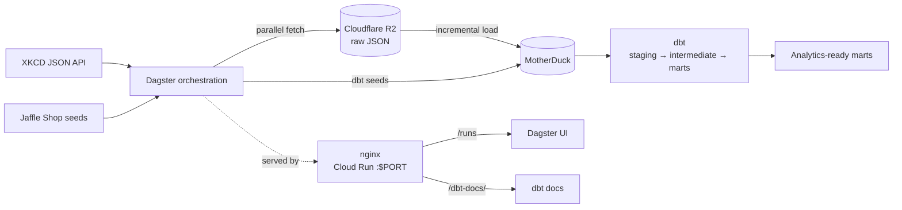

# Analytics Engineering — XKCD & Jaffle Shop Pipeline

An end-to-end analytics engineering project covering scheduled ingestion, raw data storage, dbt transformation, Dagster orchestration, and containerized delivery for two data domains.

## Situation

XKCD has published comics three times a week since 2005. The archive covers technology, science, mathematics, internet culture, video games, and everyday life. The XKCD JSON API exposes comic metadata, including titles, publication dates, image URLs, transcripts, and alt text.

A trend-tracking firm wants to study how public interests have changed over two decades, with a specific focus on video games and gaming culture. The long-term goal is to identify themes with a high chance of adoption and use those insights in product development planning.

The source data is available, but there was no automated system to:

- collect the complete comic history,
- preserve the raw API responses,
- load the data into an analytical warehouse,
- clean and model it into reliable marts,
- orchestrate recurring runs,
- expose the resulting pipeline and documentation.

The Jaffle Shop domain is included as a second dataset for exercising seed ingestion, staging models, dimensional modeling, and domain-level orchestration.

## Task

Build the data foundation required for historical trend analysis:

1. Incrementally ingest XKCD comics without re-downloading existing records.
2. Keep raw JSON in a durable landing zone before loading it into the warehouse.
3. Load new comics into MotherDuck and make the process repeatable.
4. Transform raw data with dbt into staging, intermediate, and mart layers.
5. Model the Jaffle Shop seeds through separate staging and mart layers.
6. Orchestrate ingestion and transformation as independent, observable Dagster jobs.
7. Package the orchestration UI and dbt documentation into one deployable container.

AI-generated trend analysis and product-development recommendations are the next phase. The current implementation delivers the ingestion and transformation foundation those agents will consume.

## Action



### 1. XKCD ingestion

- A Dagster schedule runs the comics ingestion job every Monday, Wednesday, and Friday at 08:00.
- The pipeline asks the XKCD API for the latest comic number, compares it with comics already stored in Cloudflare R2, and downloads only missing IDs.
- Comic #404 is skipped because it is the site's "not found" page.
- Downloads use a thread pool with 20 workers and are written as one JSON file per comic under the `raw_comics` prefix.
- Existing files are not fetched again unless a full refresh is requested.
- A second asset loads missing R2 files into MotherDuck in batches, using the `ingest.raw_comics_v2` table.
- Raw JSON remains in R2 as the landing zone; MotherDuck contains the queryable warehouse copy.

### 2. Jaffle Shop ingestion

- Six source CSVs are loaded as dbt seeds into the `raw` schema.
- The six seed assets are chained sequentially to avoid concurrent schema creation and write conflicts in MotherDuck.
- A seed asset sensor launches the Jaffle Shop transformation job after the final seed is materialized.

### 3. dbt transformation

The dbt project uses a domain-first structure:

| Domain | Layers | Main output |
| --- | --- | --- |
| Comics | staging → intermediate → marts | Incremental comics mart plus a calendar dimension |
| Jaffle Shop | staging → marts | Orders, customers, order items, products, locations, and supplies marts |

- Staging models standardize and deduplicate source data.
- The comics intermediate model adds publication dates, text metrics, null indicators, and keys.
- The comics mart is incremental and keyed by comic number.
- Jaffle Shop marts model orders, customers, and related dimensional entities.
- Models, sources, and columns are covered by dbt tests and documentation.

### 4. Dagster orchestration

The pipeline is split into four jobs:

| Domain | Ingestion job | Transformation job |
| --- | --- | --- |
| Comics | `comics_ingestion_job` | `comics_transformation_job` |
| Jaffle Shop | `jaffle_shop_ingestion_job` | `jaffle_shop_transformation_job` |

- Each job selects only the assets for its own domain and stage.
- Asset sensors start transformation automatically after the upstream ingestion handoff.
- The dbt project is exposed through Dagster's dbt component, so individual models and tests appear as observable assets.
- A runtime `full_refresh` option supports rebuilding selected models when needed.

### 5. Packaging and delivery

- The container runs Dagster and nginx together under supervisord.
- nginx exposes the Cloud Run `$PORT` and proxies:
  - `/runs` to the Dagster UI,
  - `/dbt-docs/` to generated dbt documentation.
- dbt docs are generated at startup, with a temporary local DuckDB fallback if MotherDuck is unavailable.
- The image installs dependencies from the lockfile-generated `requirements.txt` and uses the existing dbt profile through `DBT_PROFILES_DIR`.

## Result

The project now has a working data pipeline with clear separation between domains and processing stages:

- XKCD ingestion is scheduled, incremental, and backfill-capable.
- Raw comic JSON is preserved in Cloudflare R2.
- MotherDuck contains the queryable raw comics table.
- dbt produces comics marts for trend analysis and Jaffle Shop marts for dimensional reporting.
- Dagster exposes four jobs, two transformation sensors, and one recurring schedule.
- A single container can serve both the Dagster UI and dbt docs from Cloud Run.
- Validation completed with `dg list defs`, `dbt parse --target motherduck_dev`, and the local dbt-docs fallback.
- A local validation run loaded 3,302 comics and produced 3,302 rows in the comics mart.

The AI layer is not implemented yet. The current result is the production-style ingestion, transformation, orchestration, and delivery foundation that will feed future trend-analysis agents and product-planning workflows.

## Quick start

### Local

```bash
cd ingestion/orchestration_dagster
uv sync
source .venv/bin/activate
dg dev
```

Open `http://localhost:3000` to view the Dagster UI.

Set `MOTHERDUCK_TOKEN`, `R2_ACCOUNT_ID`, `R2_ACCESS_KEY_ID`, and `R2_SECRET_ACCESS_KEY` in `ingestion/orchestration_dagster/.env` before running ingestion jobs.

### Public access

| Resource | URL |
| --- | --- |
| Dagster UI | https://analytics-dagster-bolcwt6srq-nn.a.run.app/runs |
| dbt docs | https://analytics-dagster-bolcwt6srq-nn.a.run.app/dbt-docs/ |

Health check: https://analytics-dagster-bolcwt6srq-nn.a.run.app/server_info

## Repository map

| Path | Purpose |
| --- | --- |
| `ingestion/orchestration_dagster/` | Dagster assets, jobs, schedules, sensors, and dbt integration |
| `transformation_dbt/domain_data_products/` | dbt project, models, seeds, macros, and tests |
| `docker/` | nginx, supervisor, and container startup scripts |
| `Dockerfile` | Cloud Run image definition |
| `requirements.txt` | Python dependencies exported from `uv.lock` |
