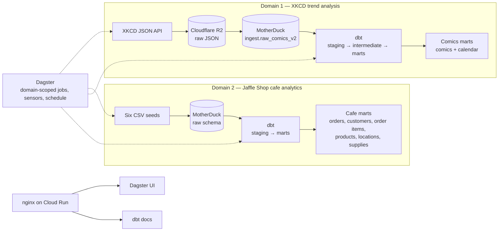

# Analytics Engineering — XKCD & Jaffle Shop Pipeline

`Analytics engineering` takes raw, messy data and transforms it into clean, reliable, and well-structured datasets so that companies can solve business problems accurately.

This repository applies that discipline end to end across two independent data domains. Both use the same lifecycle — ingestion, raw storage, dbt transformation, orchestration, and containerized delivery — but they answer different business questions.

- **Domain 1 — XKCD:** tracks how technology, science, and gaming culture appear in comic text over two decades.
- **Domain 2 — Jaffle Shop:** models cafe sales, customers, products, stores, and supplies for operational reporting.

Shared platform capabilities:

- scheduled ingestion and durable raw storage,
- dbt transformation into tested marts,
- Dagster orchestration and containerized delivery,
- a semantic layer (Malloy publisher) — work in progress,
- an AI trend-analysis agent for Domain 1 — work in progress.

## Objective

A practical demonstration of analytics engineering: structured, tested, and version-controlled data processing built to solve real business problems.

## Domain map

| Domain | Business problem | Source | End-to-end path |
| --- | --- | --- | --- |
| **XKCD** | How public interest in technology, science, and gaming culture shifted over two decades, to guide game-development decisions. | XKCD JSON API | API → Cloudflare R2 → MotherDuck → dbt staging/intermediate/marts → Dagster + dbt docs |
| **Jaffle Shop** | How a cafe is performing across sales, customers, products, stores, and supplies. | Six CSV seeds from dbt Labs | CSV seeds → MotherDuck `raw` schema → dbt staging/marts → Dagster + dbt docs |

Both domains are complete, independent implementations of the same lifecycle. They have separate ingestion paths, dbt layers, marts, and transformation jobs; they share the warehouse, dbt project, orchestration platform, and delivery container.

## Domain 1 — XKCD: trend analysis for game development

XKCD is implemented end to end as its own pipeline: API ingestion → Cloudflare R2 → MotherDuck → dbt comics marts → Dagster jobs and docs.

### Project overview (SOAR)

* **Situation:**

XKCD publishes new comics three times a week (Monday, Wednesday, Friday) and has been running since 2005. The comics cover a huge variety of topics, including:
  * **Technology & Computers:** Coding, software bugs, security passwords, automation, and the rise of artificial intelligence.
  * **Science & Math:** Physics, space exploration, statistics, data visualization, and biology.
  * **Geek Culture & Sci-Fi:** Video games, movies, internet culture, and nerdy humor.
  * **Everyday Life:** Relationships, social awkwardness, philosophy, and human quirks.

Source 1: https://xkcd.com/
          https://xkcd.com/about/
          An interface for automated systems to access comics and metadata:
          the JSON interface, at URLs like https://xkcd.com/info.0.json (current comic) and https://xkcd.com/614/info.0.json (comic #614).

* **Obstacle:**
There was no automated system to automatically collect these comics, save them to a database, clean them up for reporting, and share the final results with clear documentation and presentation slides.

* **Why?**
    **The Business Problem:** A trend-tracking firm wants to monitor how public discourse around technology, science, and pop culture shifts over two decades.

* **Why?**
    Specifically, the goal is to understand shifting public interests and desires regarding **video games** and gaming culture.

* **Why?**
    To identify potential directions for game development with a high chance of adoption, minimizing financial risk and maximizing the likelihood of success.

* **The Solution:**
    Analyzing historical text data from XKCD allows researchers to track how specific tech keywords and cultural themes evolved year by year. Once the data is collected, AI agents consume it to automatically produce deep trend analyses and strategic insights—which are then directly used to draft the Product Development Plan (PDP) and guide future game design concepts.

* **Action:**
Built a complete data project from scratch. I set up version control, wrote code to fetch the comics, stored them in a database, cleaned the data for analysis, and created full documentation and presentation slides.

* **Result:**
Created a working, automated system that turns messy web data into clean, organized information ready for reports and presentations.

### Technical implementation

- A Dagster schedule runs the comics ingestion job every Monday, Wednesday, and Friday at 08:00.
- The pipeline asks the XKCD API for the latest comic number, compares it with comics already stored in Cloudflare R2, and downloads only missing IDs.
- Comic #404 is skipped because it is the site's "not found" page.
- Downloads use a thread pool with 20 workers and are written as one JSON file per comic under the `raw_comics` prefix.
- Existing files are not fetched again unless a full refresh is requested.
- A second asset loads missing R2 files into MotherDuck in batches, using the `ingest.raw_comics_v2` table.
- Raw JSON remains in R2 as the landing zone; MotherDuck contains the queryable warehouse copy.
- dbt transforms the raw comics through staging and an intermediate model into an incremental comics mart keyed by comic number.

## Domain 2 — Jaffle Shop: cafe operations analytics

Jaffle Shop is dbt Labs' canonical sample dbt project for a fictional cafe business. The upstream project contains 13 models that transform cafe data about customers, locations (stores), products, supplies, and orders, plus six CSV seed files containing the raw sample data.

This domain is implemented end to end as its own pipeline: six CSV seeds → MotherDuck `raw` schema → dbt cafe marts → Dagster jobs and docs.

Source: [dbt Developer Hub — Clone the Jaffle Shop sample project](https://docs.getdbt.com/guides/clone-jaffle-shop) · [dbt-labs/jaffle-shop](https://github.com/dbt-labs/jaffle-shop)

### Project overview (SOAR)

* **Situation:**

A fictional cafe records its customers, stores, products, supplies, orders, and order items in six CSV files. The files contain the raw operational data but are not joined, tested, or documented for reporting.

* **Obstacle:**
There was no tested, documented data model that could combine those files into reliable reporting tables. Answering questions about revenue, customer behavior, product performance, or store performance required manual spreadsheet work.

* **Why?**
    **The Business Problem:** Cafe operators need a consistent view of sales, customers, products, locations, and supply usage to make day-to-day and planning decisions.

* **Why?**
    Specifically, the goal is to understand revenue, order composition, customer lifetime value, product and store performance, and supply costs.

* **Why?**
    To replace manual spreadsheet reporting with reusable, tested marts that support repeatable operational and commercial decisions.

* **The Solution:**
    Load the six CSV files into a raw schema, standardize them through dbt staging models, and build dimensional marts for orders, customers, order items, products, locations, and supplies. Tests and documentation make the results trustworthy and reusable.

* **Action:**
    Built seed assets for the six CSV files, chained them to avoid concurrent writes in MotherDuck, added a sensor that starts the Jaffle Shop transformation job after the final seed, and created the staging and mart models with dbt tests and documentation.

* **Result:**
    A tested, documented cafe analytics layer that runs through the same orchestration and delivery platform as the XKCD domain.

### Technical implementation

- The six source CSVs from the official [dbt Jaffle Shop sample project](https://docs.getdbt.com/guides/clone-jaffle-shop) are loaded as dbt seeds into the `raw` schema.
- The six seed assets are chained sequentially to avoid concurrent schema creation and write conflicts in MotherDuck.
- A seed asset sensor launches the Jaffle Shop transformation job after the final seed is materialized.
- dbt builds staging models and marts for orders, customers, order items, products, locations, and supplies.

## Shared platform

Both domains share the same tooling and delivery path, while remaining isolated at the domain level. The shared layer provides storage, transformation, orchestration, and access; each domain decides what its data means and which marts it produces.

### Architecture



### dbt project structure

The dbt project uses a domain-first structure:

| Domain | Layers | Main output |
| --- | --- | --- |
| Comics | staging → intermediate → marts | Incremental comics mart plus a calendar dimension |
| Jaffle Shop | staging → marts | Orders, customers, order items, products, locations, and supplies marts |

- Staging models standardize and deduplicate source data.
- The comics intermediate model adds publication dates, text metrics, null indicators, and keys.
- The comics mart is incremental and keyed by comic number.
- Jaffle Shop marts model orders, customers, and related dimensional entities.
- Models, sources, and columns are covered by dbt tests and documentation.

### Dagster orchestration

The pipeline is split into four domain-scoped jobs:

| Domain | Ingestion job | Transformation job |
| --- | --- | --- |
| Comics | `comics_ingestion_job` | `comics_transformation_job` |
| Jaffle Shop | `jaffle_shop_ingestion_job` | `jaffle_shop_transformation_job` |

- Each job selects only the assets for its own domain and stage.
- Asset sensors start transformation automatically after the upstream ingestion handoff.
- The dbt project is exposed through Dagster's dbt component, so individual models and tests appear as observable assets.
- A runtime `full_refresh` option supports rebuilding selected models when needed.

### Packaging and delivery

- The container runs Dagster and nginx together under supervisord.
- nginx exposes the Cloud Run `$PORT` and proxies:
  - `/runs` to the Dagster UI,
  - `/dbt-docs/` to generated dbt documentation.
- dbt docs are generated at startup, with a temporary local DuckDB fallback if MotherDuck is unavailable.
- The image installs dependencies from the lockfile-generated `requirements.txt` and uses the existing dbt profile through `DBT_PROFILES_DIR`.

## Result by domain

### Domain 1 — XKCD

- Ingestion is scheduled, incremental, and backfill-capable.
- Raw comic JSON is preserved in Cloudflare R2.
- MotherDuck contains the queryable raw comics table.
- dbt produces an incremental comics mart and a calendar dimension for trend analysis.
- A local validation run loaded 3,302 comics and produced 3,302 rows in the comics mart.

### Domain 2 — Jaffle Shop

- Six seed assets load the CSV files into the `raw` schema.
- dbt builds staging models and marts for orders, customers, order items, products, locations, and supplies.
- The seed sensor connects Jaffle Shop ingestion to the Jaffle Shop transformation job.
- Models, sources, and columns are covered by dbt tests and documentation.

### Shared platform

- Dagster exposes four domain-scoped jobs, two transformation sensors, and one recurring schedule.
- `dg list defs` resolves the jobs, sensors, schedules, and dbt assets.
- `dbt parse --target motherduck_dev` validates the dbt project.
- A single container serves both the Dagster UI and dbt docs from Cloud Run.
- The local dbt-docs fallback works when MotherDuck is unavailable.

The Malloy semantic layer and AI trend-analysis agent are not implemented yet. The current result is the production-style ingestion, transformation, orchestration, and delivery foundation that will feed those future layers.

## Quick start

### Local

```bash
cd ingestion/orchestration_dagster
uv sync
source .venv/bin/activate
dg dev
```

Open `http://localhost:3000` to view the Dagster UI. Run `comics_ingestion_job` or `jaffle_shop_ingestion_job` to exercise either domain independently.

Set `MOTHERDUCK_TOKEN`, `R2_ACCOUNT_ID`, `R2_ACCESS_KEY_ID`, and `R2_SECRET_ACCESS_KEY` in `ingestion/orchestration_dagster/.env` before running ingestion jobs.

### Public access

| Resource | URL |
| --- | --- |
| Dagster UI | https://analytics-dagster-bolcwt6srq-nn.a.run.app/runs |
| dbt docs | https://analytics-dagster-bolcwt6srq-nn.a.run.app/dbt-docs/ |

Health check: https://analytics-dagster-bolcwt6srq-nn.a.run.app/server_info

## Repository map

| Area | Path | Purpose |
| --- | --- | --- |
| Shared | `ingestion/orchestration_dagster/` | Dagster assets, jobs, schedules, sensors, and dbt integration |
| Domain 1 — XKCD | `ingestion/orchestration_dagster/src/orchestration_dagster/defs/step_0_ingestion_comics.py` | XKCD API discovery and download |
| Domain 1 — XKCD | `ingestion/orchestration_dagster/src/orchestration_dagster/defs/step_1_ingestion_comics.py` | R2 → MotherDuck loading |
| Domain 2 — Jaffle Shop | `ingestion/orchestration_dagster/src/orchestration_dagster/defs/step_1_ingestion_jaffle_shop.py` | Six CSV seed assets |
| Shared | `ingestion/orchestration_dagster/src/orchestration_dagster/defs/step_2_transformation_dbt.py` | dbt transformation assets |
| Domain 1 — XKCD | `transformation_dbt/domain_data_products/models/comics/` | Comics staging, intermediate, and marts |
| Domain 2 — Jaffle Shop | `transformation_dbt/domain_data_products/models/jaffle_shop/` | Cafe staging and marts |
| Domain 2 — Jaffle Shop | `transformation_dbt/domain_data_products/seeds/` | Six source CSV files |
| Shared | `docker/` | nginx, supervisor, and container startup scripts |
| Shared | `Dockerfile` | Cloud Run image definition |
| Shared | `requirements.txt` | Python dependencies exported from `uv.lock` |
