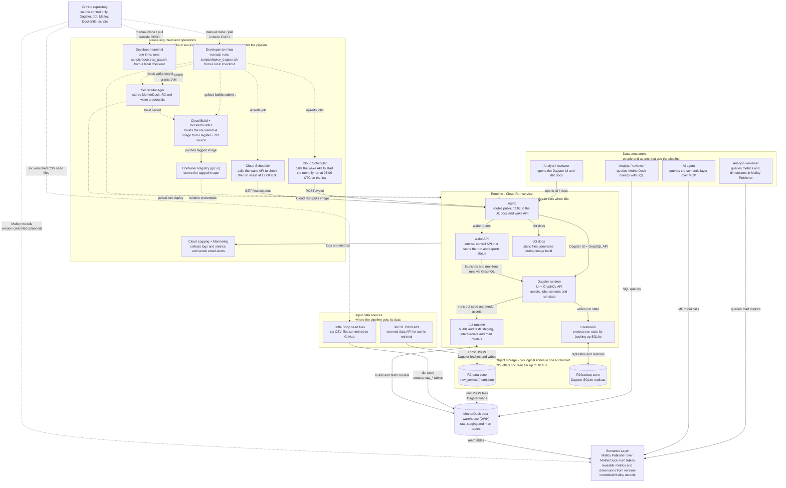
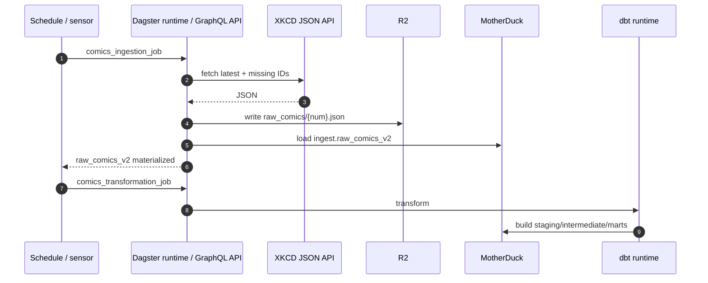
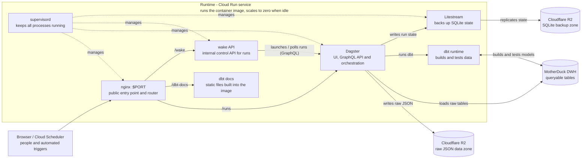

# Why?


**The Economics of Data, Analytics, and Digital Transformation by Bill Schmarzo**:
"One of the most significant impediments (`obstacles or things that slow down or block progress`) to realizing the economic value of one's data that was identified in the Economic Value of Data research was "orphaned analytics."

`Orphaned analytics` are one-off analytics developed to address a specific business need but never "operationalized" or packaged for reuse across the organization.

  - "Organizations lack an overarching framework to ensure that the resulting analytics and associated organizational intellectual capital can be captured and reused across multiple use cases. Without this over-arching analytics framework, organizations end up playing a game of analytics "whack-a-mole" where the analytics team focuses their precious and valuable resources on those immediate (urgent) problems, short-changing the larger, more strategic analytic opportunities."

"**The modern organization needs an overarching analytic module framework to help organizations to capture, share, reuse, and refine the organization's analytic `Intellectual Property (IP)`. For organizations to succeed in the 21st century, they `must invest the data science and engineering time` and discipline to master the `development of composable, reusable, continuously learning analytic modules`....that `deliver pre-defined business or operational outcomes`.**"


"The ability to leverage AI to create assets that appreciate (not depreciate) in value the more that they are used is a business and economics game-changer."


 - `digitalization`, which is the integration of digital technologies such as web-based apps, mobile devices, and sensors into existing operational processes

 - `Digital Transformation`, on the other hand, leverages the growing wealth of Big Data and Internet of Things (IoT) with continuously learning AI **to uncover new customer, product, service, and operational insights (propensities)** to **reinvent the organization's business models**, to derive and drive new sources of customer, product, and operational value.


# Analytics Engineering — XKCD & Jaffle Shop

`Analytics engineering` turns raw, messy data into clean, tested, documented datasets. Analytics engineers package this work as reusable analytic modules that teams can consume for business outcomes.

This repository applies that discipline to two independent domains on one shared platform:
- Dagster for orchestration,
- MotherDuck/DuckDB for storage,
- dbt for transformation, and
- Cloud Run for delivery.


Each domain owns its ingestion path, dbt models, marts, and business logic. Both pipelines and the Malloy semantic layer are implemented end to end; the AI trend-analysis agent remains a roadmap item.

[Public access](#public-access) · [Architecture](#architecture) · [Orchestration](#orchestration-and-delivery) · [Quick start](#quick-start) · [Repository map](#repository-map)

## Public access

| Resource | URL |
| --- | --- |
| Dagster UI | https://analytics-dagster-bolcwt6srq-nn.a.run.app/runs |
| dbt docs | https://analytics-dagster-bolcwt6srq-nn.a.run.app/dbt-docs/ |
| Health check | https://analytics-dagster-bolcwt6srq-nn.a.run.app/server_info |

## At a glance

| Domain | Business question | Source | Primary outputs |
| --- | --- | --- | --- |
| **XKCD** | How have technology, science, and gaming themes changed since 2005, and where should game development invest next? | XKCD JSON API | Incremental `comics` mart and `calendar` dimension |
| **Jaffle Shop** | How is a cafe performing across sales, customers, products, stores, and supplies? | Six CSV seeds from dbt Labs | `cafe_orders`, `cafe_customers`, `cafe_order_items`, `cafe_products`, `cafe_locations`, and `cafe_supplies` marts |

- **Implemented:** both ingestion and transformation pipelines, tests, documentation, orchestration, containerized deployment, the Malloy semantic layer, and automated Credible publishing plus Publisher rebuild/deploy.
- **Roadmap:** AI trend-analysis agent for XKCD.

## Architecture

**DWH** means **data warehouse**: the central database that stores raw, staged, and analytics-ready data and executes the transformation queries. In this project the DWH is **MotherDuck**, a cloud service built on DuckDB.

**API** means **application programming interface**: a defined way for one system to call another to exchange data or trigger an action. Three APIs are central to the architecture: the **XKCD JSON API** (external data API for comic retrieval), the **wake API** (internal control API inside the Cloud Run service, called by Cloud Scheduler), and the **Dagster GraphQL API** (internal orchestration API used by the Dagster UI and the wake API to launch and monitor runs).



MotherDuck and Dagster are shared by both domains. Object storage and the data warehouse are shown separately: the **R2** box keeps files and backups, while **MotherDuck** keeps queryable tables and runs SQL. R2 is split into two logical zones within the same bucket: the `raw_comics/` prefix is XKCD's JSON landing zone, while the `dagster_home/` prefix holds Litestream replicas of Dagster's SQLite state. The solid arrows show data lineage; Dagster executes the XKCD fetch, R2 write/read, and MotherDuck load. Jaffle Shop's raw layer is loaded into MotherDuck by `dbt seed` from the six CSV files committed to GitHub.

> **Cloud Run service, not a Cloud Run Job.** The deployed compute is a request-driven Cloud Run **service** with `min-instances=0` and `max-instances=1`. Cloud Scheduler wakes it over HTTPS; it is not a batch Cloud Run Job. See [Orchestration and delivery](#orchestration-and-delivery).

> **GitHub's role: source control, not Dagster CI/CD.** GitHub stores the Dagster code, dbt project, Dockerfile, release scripts, and seed CSVs. No GitHub Actions workflow builds or deploys the Dagster service, and there is no Cloud Build GitHub trigger for it. A developer clones or pulls the repository and runs `scripts/deploy_dagster.sh` manually from a local terminal; `gcloud builds submit .` uploads that working tree to Cloud Build, and the resulting image is deployed to Cloud Run. Automating this Dagster path is a roadmap item. The separate semantic-layer publish/deploy path is automated; see [`semantic_layer/README.md`](./semantic_layer/README.md).

> **How Secret Manager is populated.** `scripts/bootstrap_gcp.sh` is a shell script run manually once from a developer terminal — not by Docker or Cloud Build. It enables Secret Manager, creates `wake-shared-secret`, and grants the runtime and build identities access. The MotherDuck and R2 secrets must already exist; create them manually with `gcloud secrets create` or the Google Cloud console. Cloud Build then consumes `motherduck-token` at build time, while `scripts/deploy_dagster.sh` reads `wake-shared-secret` and passes runtime secret references to Cloud Run.

> **Docker's role: build, not runtime.** Docker is not a separate deployed service. The `Dockerfile` defines the image, `cloudbuild.yaml` runs `docker build` with BuildKit inside Cloud Build, Cloud Build pushes the tagged image to Container Registry, and `scripts/deploy_dagster.sh` deploys that image to the Cloud Run service. Cloud Run runs the resulting container; there is no Docker daemon inside the service.

> **dbt: packaged at build time, executed at runtime.** The dbt project (models, seeds, tests, macros) is copied into the image and `dbt deps` plus `dbt docs generate` run during the image build, but no warehouse transformations or data tests run then. At runtime, Dagster launches the dbt assets, which build and test the models against MotherDuck. The diagram therefore keeps **dbt runtime** in the Cloud Run group.

### Component responsibilities

| Functional role | Technology | Responsibility |
| --- | --- | --- |
| **Input sources** | XKCD JSON API (external data API); six Jaffle Shop CSV seed files | Provide the two domains' source data. |
| **Source control** | [GitHub repository](https://github.com/antipev/analytics-engineering) | Stores Dagster code, dbt models/seeds/tests, Dockerfile, release scripts, and seed CSVs. Bootstrap and release are manual from a developer terminal; there is no GitHub Actions or Cloud Build trigger. |
| **Scheduling** | Cloud Scheduler | Starts `POST /wake` monthly at 08:00 UTC and checks `GET /wake/status` at 12:00 UTC; retries failures. |
| **Container image** | Dockerfile + Docker/BuildKit | Packages Dagster and dbt source, generated static dbt docs, Python 3.12, nginx, and Litestream into the `linux/amd64` image. |
| **Build and release** | Developer terminal + Cloud Build + Container Registry + `scripts/deploy_dagster.sh` | The release script is run manually and submits the local checkout to Cloud Build, which runs the Docker build and pushes the tagged image; the script then deploys it to Cloud Run and upserts both Scheduler jobs. |
| **Container compute** | Cloud Run service (one container, min 0 / max 1) | Runs the packaged image: nginx, wake API, Dagster runtime, dbt runtime, static dbt docs, and Litestream; scales to zero when idle. |
| **HTTP entry point** | nginx | Routes public traffic to the Dagster UI/GraphQL API, static dbt docs, and the wake endpoints. Cloud Run terminates TLS at the edge. |
| **Run control** | Starlette/uvicorn wake API (internal control API) | Authenticates Scheduler, calls Dagster's GraphQL API to launch the monthly ingestion idempotently, waits for the sensor-triggered transformation, and reports status. |
| **Orchestration** | Dagster runtime (webserver + GraphQL API) | Defines assets, jobs, the monthly schedule, and two asset sensors; serves the UI and GraphQL API; stores run and schedule state in SQLite. |
| **Transformation** | dbt runtime | Executes only when Dagster launches the dbt assets; builds staging/intermediate/mart models and runs tests against the DWH. |
| **Data warehouse (DWH)** | MotherDuck on DuckDB (free tier 10 GB for individuals) | Stores queryable raw, staging, and mart tables and executes dbt SQL. |
| **Semantic layer** | Malloy Publisher + Credible | Publishes reusable metrics and dimensions over the MotherDuck mart tables, managed from the `semantic_layer/workspace/` packages and deployed automatically after a successful Credible publish. |
| **Object storage** | Cloudflare R2 (free tier up to 10 GB) | Two logical zones in one bucket: `raw_comics/` stores raw XKCD JSON, and `dagster_home/` stores Litestream backups of Dagster's SQLite state. |
| **State protection** | Litestream + restore script | Replicates SQLite continuously and restores run history and schedule state before Dagster starts on a cold instance. |
| **Configuration** | Secret Manager + environment variables | `bootstrap_gcp.sh`, run manually, creates `wake-shared-secret` and grants IAM; MotherDuck and R2 secrets must exist beforehand. Cloud Build reads `motherduck-token` for build-time dbt docs; the deploy script reads `wake-shared-secret` and injects runtime secret references into Cloud Run. No secret is baked into the image. |
| **Observability** | Cloud Logging + Cloud Monitoring | Converts failure logs into metrics and sends email alerts. |

### Monthly request path

1. **08:00 UTC on the 1st:** Cloud Scheduler sends an authenticated `POST /wake` to the wake API. Cloud Run starts the container from zero if needed, restores Dagster state from R2, and starts nginx, Dagster, the wake API, and Litestream.
2. **Ingestion:** the wake API launches `comics_ingestion_job` idempotently. Dagster downloads only missing comics from the XKCD API into R2, then loads them into `MotherDuck.ingest_xkcd.raw_comics_v2`.
3. **Transformation:** materializing `raw_comics_v2` fires the asset sensor, which launches `comics_transformation_job`. dbt builds and tests the staging, intermediate, and mart models in MotherDuck.
4. **Confirmation:** `/wake` waits for both runs and returns success only when both succeed. At **12:00 UTC**, a second Scheduler job calls `GET /wake/status` as a dead-man's-switch; failures produce structured logs and email alerts.
5. **Idle:** the service scales back to zero. MotherDuck keeps the analytics tables; R2 keeps raw JSON and the replicated Dagster run/schedule state.

## Domain 1 — XKCD

**Business question.** How did public interest in technology, science, and gaming culture shift over two decades, and which directions are most likely to succeed in game development?

**Why it matters.** Tracking themes year by year helps identify topics with adoption potential, reducing the financial risk of new game concepts.

**Pipeline.**
- On the first day of each month at 08:00 UTC, Cloud Scheduler calls `POST /wake`. The endpoint launches `comics_ingestion_job` and waits for the sensor-triggered transformation. The in-code Dagster schedule exists but is stored as `STOPPED`; Cloud Scheduler is the single monthly trigger.
- The job reads the latest comic number from the XKCD API, compares it with the IDs already stored in R2, and downloads only the gaps. Comic #404 is skipped because the site returns its "not found" page for that ID.
- Downloads use a 20-worker thread pool and write one JSON file per comic under `raw_comics/`. A `full_refresh` option re-downloads everything.
- A second asset loads missing R2 files into MotherDuck in batches as `ingest_xkcd.raw_comics_v2`. Raw JSON remains in R2; MotherDuck holds the queryable copy.
- dbt moves the data through `stg_comics` and `int_comics` into an incremental `comics` mart keyed by comic number, plus a `calendar` dimension.

**Outputs.** A tested, documented comics mart ready for keyword and trend analysis. Sources: [xkcd.com](https://xkcd.com/) · [JSON API](https://xkcd.com/info.0.json).

## Domain 2 — Jaffle Shop

**Business question.** How is the cafe performing across sales, customers, products, stores, and supplies?

**Why it matters.** Operators need one consistent view of revenue, order composition, customer lifetime value, product and store performance, and supply costs instead of manual spreadsheet reporting.

**Pipeline.**
- Six CSV seeds from the [dbt Jaffle Shop project](https://github.com/dbt-labs/jaffle-shop) load into MotherDuck's `ingest_jaffle_shop` schema: `raw_customers`, `raw_orders`, `raw_items`, `raw_stores`, `raw_products`, and `raw_supplies`.
- The seed assets are chained in that order to avoid concurrent schema creation and write conflicts.
- Materializing the final seed, `raw_supplies`, triggers `jaffle_shop_transformation_job`.
- dbt builds staging models and six `cafe_` marts: `cafe_customers`, `cafe_orders`, `cafe_order_items`, `cafe_products`, `cafe_locations`, and `cafe_supplies`.

**Outputs.** A tested, documented cafe analytics layer covering the full sales and operations lifecycle.

## Orchestration and delivery

| Domain | Ingestion job | Transformation job | Trigger |
| --- | --- | --- | --- |
| XKCD | `comics_ingestion_job` | `comics_transformation_job` | Cloud Scheduler `POST /wake` at 08:00 UTC on the 1st; sensor on `raw_comics_v2` |
| Jaffle Shop | `jaffle_shop_ingestion_job` | `jaffle_shop_transformation_job` | Manual/local run; sensor on `raw_supplies`, the final seed |



Jaffle Shop follows the same handoff pattern: six chained seeds replace the XKCD API/R2 step, and the final seed triggers its transformation job.


*Dagster's global asset lineage shows both domains, from raw assets through their final marts.*



- nginx exposes the public Cloud Run port and proxies `/runs`, `/dbt-docs/`, `/wake`, and `/wake/status`.
- dbt project code is copied into the image at build time; transformations and tests execute only when Dagster launches the dbt assets.
- dbt docs are generated at image-build time and served as static files, so a cold start does not need to query MotherDuck for catalog metadata.
- `/wake` is authenticated with the `X-Wake-Secret` header and can wait up to 25 minutes (1500 seconds), behind a 30-minute Scheduler and proxy deadline.
- Litestream replicates Dagster's SQLite databases to the R2 backup zone; the entrypoint restores them before Dagster starts. Raw XKCD JSON lives in the R2 data zone.
- The dbt assets and seed assets expose a runtime `full_refresh` option for selected rebuilds.

## Validation

| Check | Result |
| --- | --- |
| `dg list defs` | Resolves four domain-scoped jobs, two sensors, and one schedule |
| `dbt parse --target motherduck_dev` | Validates the dbt project |
| Local XKCD run | 3,302 comics loaded and 3,302 rows in the comics mart; counts grow with each scheduled run |
| MotherDuck raw table | `ingest_xkcd.raw_comics_v2` |
| Cloud Run | One container serves the Dagster UI and dbt docs |


*dbt docs expose source descriptions, columns, and the linked Dagster asset key.*

## Quick start

### Local

```bash
cp .env.example .env        # repository root; fill in GCP, R2, and MotherDuck values
uv venv .venv --python 3.10 # first time only; one environment for the whole repo
source .venv/bin/activate
uv sync --project ingestion/orchestration_dagster --active
cd ingestion/orchestration_dagster
dg dev
```

Open `http://localhost:3000` and run `comics_ingestion_job` or `jaffle_shop_ingestion_job`.

The repository-root `.venv` is the single environment for the whole project. It contains Dagster, dbt, and every dependency from `ingestion/orchestration_dagster/uv.lock`. Because `uv` normally creates the environment next to `pyproject.toml`, dependency updates must be synced into the active root environment with `uv sync --project ingestion/orchestration_dagster --active`. Run `dg` and `dbt` from `ingestion/orchestration_dagster` so Dagster finds its `defs` directory.

`.env` in the repository root is the single environment file. Dagster loads it through `python-dotenv` (the loader walks up from the project directory), and `scripts/bootstrap_gcp.sh` / `scripts/deploy_dagster.sh` source it automatically. For dbt CLI commands, load it into the shell first from the repository root: `set -a; source .env; set +a`.

## Repository map

This map lists all 86 tracked files (plus local-only and generated paths) so the repository can be audited file by file. Exact paths are relative to the repository root. Generated artifacts and local secrets are listed separately at the end and are not part of the deployed system.

### Root, build, and deployment

| Path | Purpose |
| --- | --- |
| `README.md` | Project overview, component diagram, architecture, run instructions, validation evidence, and this inventory. |
| `Dockerfile` | Builds the Python 3.12 runtime image: installs nginx, supervisor, Litestream, and pinned Python dependencies; copies code; runs `dbt deps`; generates dbt docs at build time with an optional BuildKit secret. |
| `.dockerignore` | Keeps secrets, virtualenvs, generated dbt/Dagster state, notebooks, and `DOCUMENTATION/` out of the image build context. |
| `cloudbuild.yaml` | Cloud Build pipeline: enables BuildKit, pulls `motherduck-token` from Secret Manager, builds the `linux/amd64` image, and pushes it to Container Registry. |
| `requirements.txt` | Fully resolved, pinned Python dependency set exported from `ingestion/orchestration_dagster/uv.lock`; installed by the Docker image. |
| `.env.example` | Template for local and deployment variables: GCP project/region, alert email, R2, MotherDuck, dbt target, and monthly scheduler settings. |
| `.gitignore` | Excludes local secrets, virtualenvs, databases, logs, and generated artifacts from version control. |
| `scripts/bootstrap_gcp.sh` | One-time GCP bootstrap: enables APIs, grants secret access to runtime/build service accounts, creates `wake-shared-secret`, upserts two log-based metrics, an email notification channel, and two alert policies. |
| `scripts/deploy_dagster.sh` | Release command: builds with `cloudbuild.yaml`, deploys the Cloud Run service with scale-to-zero settings and secrets, waits for readiness, verifies dbt docs, and creates or updates both Cloud Scheduler jobs. |
| `PICTURES/Analytic Module Deployment Benefits.png` | Illustration of the business value of analytic module deployment. |
| `PICTURES/Digital Transformation.png` | Illustration of digital transformation versus digitalization. |
| `PICTURES/Dagster Lineage.png` | Screenshot evidence of global Dagster asset lineage across both domains. |
| `PICTURES/DBT Documentation.png` | Screenshot evidence of generated dbt docs, source metadata, and Dagster asset links. |

### Container runtime (`docker/`)

| Path | Purpose |
| --- | --- |
| `docker/entrypoint.sh` | Cold-start sequence: sets `DAGSTER_HOME`/dbt/R2 environment, creates state directories, restores SQLite from R2, forces the monthly schedule stopped, renders nginx for Cloud Run's `$PORT`, then starts supervisord. |
| `docker/restore_dagster_state.py` | Lists Litestream replica prefixes in R2 and restores `runs.db`, `event_log.db`, `schedules.db`, and every per-run event-log database in parallel; exits non-zero on failure so an empty state does not start silently. |
| `docker/ensure_schedule_stopped.py` | Reads restored Dagster schedule state and forces `comics_ingestion_schedule` to `STOPPED`, preventing the daemon from racing the `/wake` endpoint. |
| `docker/litestream.yml` | Litestream configuration: continuously replicates `$DAGSTER_HOME/history/*.db` and `$DAGSTER_HOME/schedules/*.db` to Cloudflare R2 with a 1-second sync interval. |
| `docker/supervisord.conf` | Process manager inside the container: starts Litestream, Dagster (`dg dev` on port 3000), the wake API (port 3001), and nginx, with restart policies and stdout/stderr logging. |
| `docker/wake_app.py` | Starlette/uvicorn service for `/wake`, `/wake/status`, and `/healthz`; validates the shared secret, launches ingestion idempotently, waits for the sensor-triggered transformation, and reports the monthly run status. |
| `docker/nginx.conf.template` | nginx template rendered with Cloud Run's `$PORT`; routes `/dbt-docs/` to static files, `/wake` and `/wake/status` to the wake API with long timeouts, and everything else to Dagster with WebSocket support. |
| `docker/start-nginx.sh` | Waits until Dagster's `/server_info` responds, then starts nginx in the foreground under supervisord. |

### Dagster orchestration (`ingestion/orchestration_dagster/`)

| Path | Purpose |
| --- | --- |
| `ingestion/orchestration_dagster/pyproject.toml` | Python project metadata and dependencies: Dagster, dagster-dbt, dbt-duckdb, DuckDB, pandas, boto3, and python-dotenv; also configures the Dagster project root. |
| `ingestion/orchestration_dagster/uv.lock` | Locked dependency graph used by `uv sync` for local development. |
| `ingestion/orchestration_dagster/README.md` | Local Dagster scaffold README (untracked); the repository-level README is authoritative. |
| `ingestion/orchestration_dagster/.gitignore` | Excludes the local virtualenv, Dagster state, and caches from version control. |
| `ingestion/orchestration_dagster/.dg/telemetry.yaml` | Dagster CLI project telemetry metadata; not used at runtime. |
| `ingestion/orchestration_dagster/src/orchestration_dagster/__init__.py` | Marks the Python package. |
| `ingestion/orchestration_dagster/src/orchestration_dagster/definitions.py` | Dagster entry point: loads all definitions from the `defs/` folder using `load_from_defs_folder`. |
| `ingestion/orchestration_dagster/src/orchestration_dagster/defs/__init__.py` | Marks the definitions package. |
| `ingestion/orchestration_dagster/src/orchestration_dagster/defs/pipeline_config.py` | Single source of truth for comic asset keys, the six Jaffle seed names, and the asset-key selection per domain. |
| `ingestion/orchestration_dagster/src/orchestration_dagster/defs/schedules.py` | Declares `comics_ingestion_schedule` for `0 8 1 * *`; `default_status=STOPPED` so Cloud Scheduler remains the only monthly trigger. |
| `ingestion/orchestration_dagster/src/orchestration_dagster/defs/sensors.py` | Two asset sensors: `raw_comics_v2` triggers `comics_transformation_job`; `raw_supplies` triggers `jaffle_shop_transformation_job`. |
| `ingestion/orchestration_dagster/src/orchestration_dagster/defs/step_0_ingestion_comics.py` | XKCD ingestion asset `raw_comics`: finds the latest comic, compares it with R2 contents, downloads missing JSON files in parallel (skipping #404), and supports `full_refresh`. |
| `ingestion/orchestration_dagster/src/orchestration_dagster/defs/step_1_ingestion_comics.py` | XKCD loading asset `raw_comics_v2`: reads missing JSON files from R2, validates them against a schema config, and inserts them into MotherDuck in batches. |
| `ingestion/orchestration_dagster/src/orchestration_dagster/defs/step_1_ingestion_jaffle_shop.py` | Defines six chained dbt seed assets (`raw_customers` through `raw_supplies`) with a runtime `full_refresh` option. |
| `ingestion/orchestration_dagster/src/orchestration_dagster/defs/step_2_transformation_dbt.py` | Discovers domain folders under `models/`, then creates `<domain>_ingestion_job` and `<domain>_transformation_job` asset jobs. |
| `ingestion/orchestration_dagster/src/orchestration_dagster/defs/transformation_dbt/component.py` | `FullRefreshDbtProjectComponent`: subclasses `DbtProjectComponent` to expose a runtime `full_refresh` toggle that adds `--full-refresh` to dbt commands. |
| `ingestion/orchestration_dagster/src/orchestration_dagster/defs/transformation_dbt/defs.yaml` | Registers the custom dbt component, points at the dbt project, excludes seed resources from the component, and assigns asset groups from the dbt FQN. |
| `ingestion/orchestration_dagster/src/orchestration_dagster/defs/transformation_dbt/template_vars.py` | Locates the dbt project, resolves the default target (`motherduck_dev`), and provides the FQN-to-group helper used by the dbt component and job factory. |
| `ingestion/orchestration_dagster/src/orchestration_dagster/defs/data/schema_config_v1.json` | Legacy XKCD raw schema (11 columns, no `extra_parts`); retained for schema-version compatibility. |
| `ingestion/orchestration_dagster/src/orchestration_dagster/defs/data/schema_config_v2.json` | Active XKCD raw schema (12 columns, including `extra_parts`) used to validate records before loading into `raw_comics_v2`. |
| `ingestion/orchestration_dagster/src/orchestration_dagster/defs/data/test_ingestion.ipynb` | Local scratch notebook for developing and debugging ingestion logic; untracked, not deployed. |
| `ingestion/orchestration_dagster/src/orchestration_dagster/defs/data/test_dbt.ipynb` | Local scratch notebook for querying dbt/MotherDuck outputs; untracked, not deployed. |
| `ingestion/orchestration_dagster/src/orchestration_dagster/defs/data/test_query.sql` | Local ad hoc MotherDuck inspection and cleanup queries; untracked, not executed by a job. |
| `ingestion/orchestration_dagster/tests/__init__.py` | Marks the test package; no test modules are currently implemented. |

### dbt project (`transformation_dbt/domain_data_products/`)

#### Project configuration

| Path | Purpose |
| --- | --- |
| `transformation_dbt/domain_data_products/dbt_project.yml` | dbt project definition: name, profile, model/macro/seed paths, `ingest_jaffle_shop` seed schema, `staging`/`intermediate`/`marts` model folders, and strict static analysis. |
| `transformation_dbt/domain_data_products/profiles.yml` | Local, gitignored connection targets: `motherduck_dev` (default cloud DWH), `duckdb_dev` (local file), and a BigQuery `dev` target. |
| `transformation_dbt/domain_data_products/packages.yml` | Declares the `dbt-labs/dbt_utils` dependency. |
| `transformation_dbt/domain_data_products/package-lock.yml` | Locks the resolved dbt package versions installed by `dbt deps`. |
| `transformation_dbt/domain_data_products/README.md` | Local upstream Jaffle Shop scaffold README (untracked); the repository-level README is authoritative. |
| `transformation_dbt/domain_data_products/.gitignore` | Excludes dbt build artifacts, packages, logs, and local user state. |
| `transformation_dbt/domain_data_products/.user.yml` | Local, gitignored dbt user ID file (untracked). |

#### Macros

| Path | Purpose |
| --- | --- |
| `transformation_dbt/domain_data_products/macros/calendar_macro.sql` | Builds the calendar dimension through a DuckDB/BigQuery-compatible date spine, including week/month/quarter/year keys and prior-period comparisons. |
| `transformation_dbt/domain_data_products/macros/cents_to_dollars.sql` | Adapter-dispatched conversion of integer cents to dollars, with implementations for DuckDB's default, BigQuery, Spark, Postgres, and Fabric. |
| `transformation_dbt/domain_data_products/macros/generate_schema_name.sql` | Uses the custom schema name directly when provided, otherwise the target's default schema. |
| `transformation_dbt/domain_data_products/macros/materialization_raw_duckdb.sql` | Custom `raw_sql` materialization for DuckDB/MotherDuck that executes the model SQL and returns its relation. |
| `transformation_dbt/domain_data_products/macros/materialization_raw_bq.sql.sql` | BigQuery implementation of the same `raw_sql` materialization. |

#### XKCD models

| Path | Purpose |
| --- | --- |
| `transformation_dbt/domain_data_products/models/comics/staging/_sources.yml` | Declares the `xkcd_duckdb` source and `raw_comics_v2` table loaded by Dagster. |
| `transformation_dbt/domain_data_products/models/comics/staging/stg_comics.sql` | Staging view that deduplicates the raw comic table by comic number. |
| `transformation_dbt/domain_data_products/models/comics/intermediate/int_comics.sql` | Adds validated publication date, text/URL aliases, null indicators, word/character counts, and the `_key_comics` key. |
| `transformation_dbt/domain_data_products/models/comics/marts/comics.sql` | Incremental `comics` mart keyed by `_key_comics`, with `_key_calendar` for the date dimension. |
| `transformation_dbt/domain_data_products/models/comics/marts/_comics.yml` | Documents the comics mart and tests key uniqueness/non-null plus the calendar relationship. |
| `transformation_dbt/domain_data_products/models/comics/marts/calendar.sql` | Table model that calls `calendar_macro` for 2006-01-01 through the current date. |
| `transformation_dbt/domain_data_products/models/comics/marts/_calendar.yml` | Documents the calendar dimension and tests its date key. |

#### Jaffle Shop staging models

| Path | Purpose |
| --- | --- |
| `transformation_dbt/domain_data_products/models/jaffle_shop/staging/_sources.yml` | Declares the `ecom` source and the six seeded raw tables used by the staging models. |
| `transformation_dbt/domain_data_products/models/jaffle_shop/staging/stg_customers.sql` | Renames raw customer columns to `customer_id` and `customer_name`. |
| `transformation_dbt/domain_data_products/models/jaffle_shop/staging/stg_customers.yml` | Documents and tests the customer staging model. |
| `transformation_dbt/domain_data_products/models/jaffle_shop/staging/stg_locations.sql` | Renames stores to locations and casts the opening timestamp to a date. |
| `transformation_dbt/domain_data_products/models/jaffle_shop/staging/stg_locations.yml` | Documents and tests the location staging model. |
| `transformation_dbt/domain_data_products/models/jaffle_shop/staging/stg_order_items.sql` | Maps raw item rows to order/item/product identifiers. |
| `transformation_dbt/domain_data_products/models/jaffle_shop/staging/stg_order_items.yml` | Documents and tests the order-item staging model. |
| `transformation_dbt/domain_data_products/models/jaffle_shop/staging/stg_orders.sql` | Renames order columns, converts cent amounts to dollars, and casts order dates. |
| `transformation_dbt/domain_data_products/models/jaffle_shop/staging/stg_orders.yml` | Documents and tests the order staging model. |
| `transformation_dbt/domain_data_products/models/jaffle_shop/staging/stg_products.sql` | Renames product fields, converts price to dollars, and derives food/drink flags. |
| `transformation_dbt/domain_data_products/models/jaffle_shop/staging/stg_products.yml` | Documents and tests the product staging model. |
| `transformation_dbt/domain_data_products/models/jaffle_shop/staging/stg_supplies.sql` | Creates a supply surrogate key and converts supply cost to dollars. |
| `transformation_dbt/domain_data_products/models/jaffle_shop/staging/stg_supplies.yml` | Documents and tests the supply staging model. |

#### Jaffle Shop marts and seeds

| Path | Purpose |
| --- | --- |
| `transformation_dbt/domain_data_products/models/jaffle_shop/marts/cafe_customers.sql` | Builds the customer mart with lifetime order counts, repeat-buyer flag, first/last order dates, and lifetime value. |
| `transformation_dbt/domain_data_products/models/jaffle_shop/marts/cafe_customers.yml` | Documents and tests the customer mart. |
| `transformation_dbt/domain_data_products/models/jaffle_shop/marts/cafe_locations.sql` | Publishes the location/store dimension as a table. |
| `transformation_dbt/domain_data_products/models/jaffle_shop/marts/cafe_order_items.sql` | Joins order items to orders, products, and supplies to calculate item revenue and cost. |
| `transformation_dbt/domain_data_products/models/jaffle_shop/marts/cafe_order_items.yml` | Documents and tests the order-item mart. |
| `transformation_dbt/domain_data_products/models/jaffle_shop/marts/cafe_orders.sql` | Builds the order mart with item counts, subtotal, tax, total, supply cost, and customer attributes. |
| `transformation_dbt/domain_data_products/models/jaffle_shop/marts/cafe_orders.yml` | Documents and tests the order mart. |
| `transformation_dbt/domain_data_products/models/jaffle_shop/marts/cafe_products.sql` | Publishes the product dimension as a table. |
| `transformation_dbt/domain_data_products/models/jaffle_shop/marts/cafe_supplies.sql` | Publishes the supply dimension as a table. |
| `transformation_dbt/domain_data_products/seeds/raw_customers.csv` | Jaffle Shop customer seed, loaded as `raw.raw_customers`. |
| `transformation_dbt/domain_data_products/seeds/raw_orders.csv` | Jaffle Shop order seed, loaded as `raw.raw_orders`. |
| `transformation_dbt/domain_data_products/seeds/raw_items.csv` | Jaffle Shop order-item seed, loaded as `raw.raw_items`. |
| `transformation_dbt/domain_data_products/seeds/raw_stores.csv` | Jaffle Shop store/location seed, loaded as `raw.raw_stores`. |
| `transformation_dbt/domain_data_products/seeds/raw_products.csv` | Jaffle Shop product seed, loaded as `raw.raw_products`. |
| `transformation_dbt/domain_data_products/seeds/raw_supplies.csv` | Jaffle Shop supply seed, loaded as `raw.raw_supplies`; materializing it triggers the Jaffle transformation sensor. |

### Semantic layer (`semantic_layer/`)

| Path | Purpose |
| --- | --- |
| `semantic_layer/workspace/comics/` | Credible/Publisher package for the XKCD domain: `publisher.json`, raw views, refinements, and `comics_explore`. |
| `semantic_layer/workspace/jaffle_shop/` | Credible/Publisher package for the Jaffle Shop domain: `publisher.json`, raw views, refinements, and `cafe_explore`. |
| `semantic_layer/publisher.config.json` | Local Publisher configuration; not uploaded to Credible or copied into the deployed image. |
| `semantic_layer/README.md` | Package layout, connection setup, publishing rules, and the `explores` deprecation note. |
| `.github/workflows/deploy.yaml` | On a push to `semantic_layer/workspace/**`, bumps changed package versions, publishes them to Credible, and commits the version bump with `[skip ci]`. |
| `.github/workflows/publish-packages.yml` | Reusable Credible publish job invoked by `deploy.yaml`. |
| `.github/workflows/bump-package-versions.yml` | Reusable version-bump job that detects changed packages and commits the new `publisher.json` versions. |
| `.github/workflows/deploy-publisher.yml` | After a successful publish, rebuilds the Publisher image from `analytics-malloy-publisher-rag`, deploys it to Cloud Run, routes 100% of traffic to the new revision, and runs the smoke test. |
| `scripts/bump_versions.py`, `scripts/detect_changed_packages.py`, `scripts/cred_publish.sh` | Helper scripts used by the publish workflows. |

### Documentation

| Path | Purpose |
| --- | --- |
| `DOCUMENTATION/1_Research/1_Cloud Storage Selection.md` | Research and decision record for the cloud storage choice. |
| `DOCUMENTATION/2_Plan_and_Implementation/0_PREPARATION.md` | Preparation notes, prerequisites, and environment setup. |
| `DOCUMENTATION/2_Plan_and_Implementation/1_PROJECT.md` | Project definition, domains, questions, and scope. |
| `DOCUMENTATION/2_Plan_and_Implementation/2_PROJECT_1_PLAN.md` | End-to-end build and operations plan, including the monthly scale-to-zero implementation, file inventory, economics, and live deployment evidence. |
| `DOCUMENTATION/2_Plan_and_Implementation/3_PROJECT_1_Docker.md` | Container and Cloud Run implementation notes, revision details, and deployment checks. |
| `DOCUMENTATION/2_Plan_and_Implementation/4_PROJECT_1_Schedule.md` | Authoritative design for scheduling, Litestream, the wake endpoint, dbt docs delivery, and alerting. |

### Generated and local-only files

These paths are intentionally excluded from version control or the image. They are rebuildable artifacts or local configuration, not hand-written system components.

| Path | Purpose |
| --- | --- |
| `.env` | The single local environment file (copy of `.env.example`): credentials and overrides; never commit or include in the image. |
| `transformation_dbt/domain_data_products/target/` | dbt docs, catalog, manifest, and run results; regenerated by `dbt docs generate`/`dbt build`. |
| `transformation_dbt/domain_data_products/dbt_packages/` | Installed dbt packages; recreated by `dbt deps`. |
| `transformation_dbt/domain_data_products/logs/` | dbt run logs. |
| `transformation_dbt/domain_data_products/package-lock.concurrent-update-lock` | Temporary package-lock coordination file. |
| `.venv/`, `**/__pycache__/`, `.pytest_cache/` | Local Python environment and caches. |
| `.vscode/settings.json` | Local VS Code workspace settings. |
| `.local_defs_state/`, `.tmp_dagster_home_*`, `$DAGSTER_HOME` | Local/generated Dagster state and temporary homes. |

## Roadmap

- **AI trend-analysis agent for XKCD** — consumes the comics mart to produce trend analyses and strategic input for game development. Not implemented yet.
- **Dagster release automation** — the Dagster image is still built and deployed manually with `scripts/deploy_dagster.sh`. Semantic-layer publish/deploy is already automated by GitHub Actions; extending that pattern to the Dagster service remains optional work.
